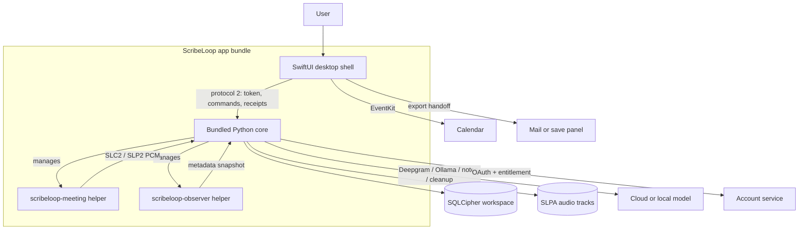
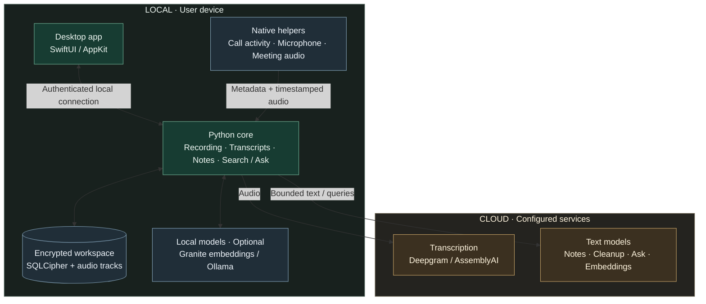
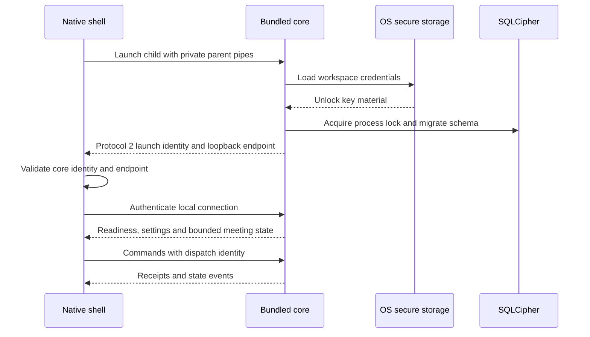
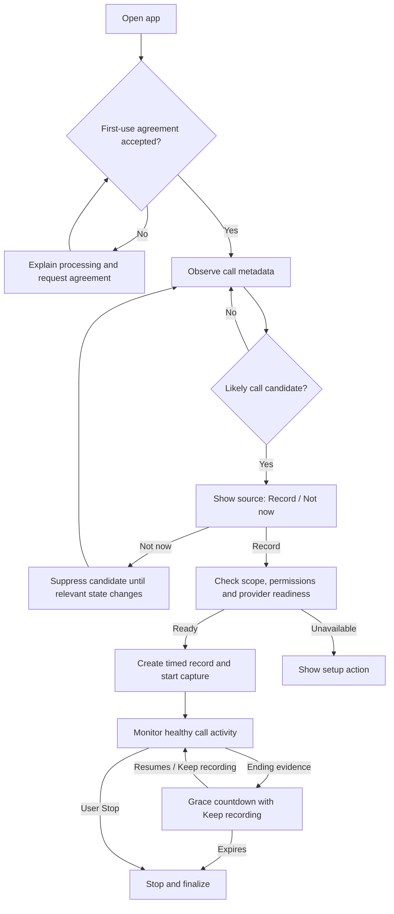
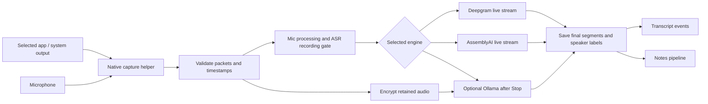
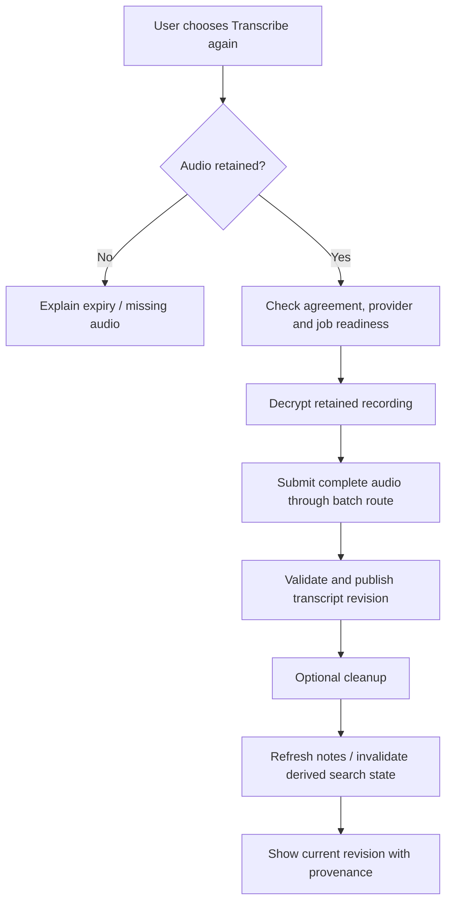
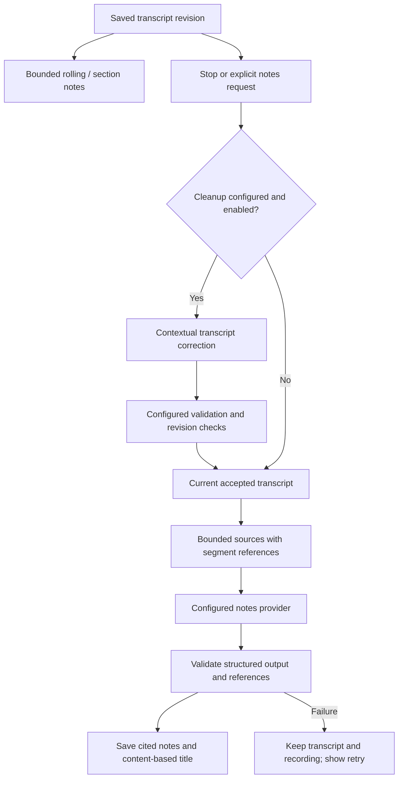
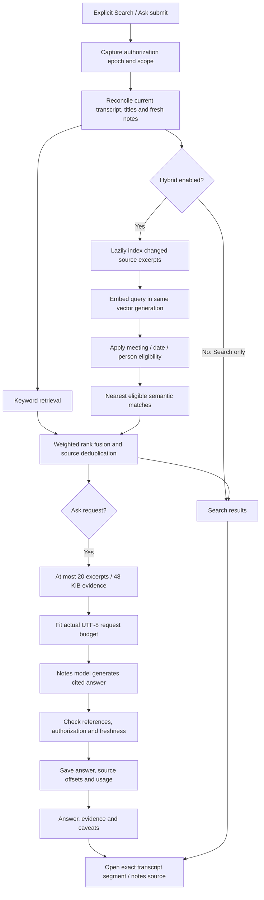
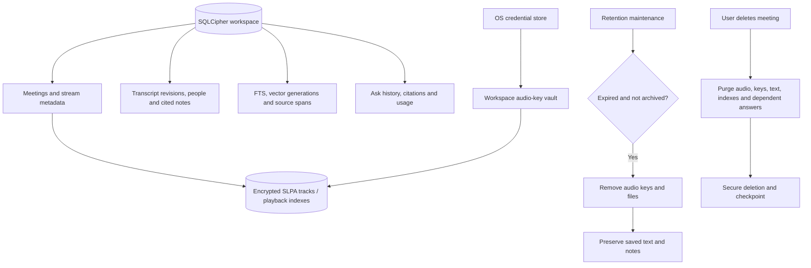

# ScribeLoop — Architecture Plan

> **Current implementation (2026-11-09):** the internal Apple Silicon macOS 13+ desktop
> build implements encrypted local capture, first-use agreement and permissions, metadata
> discovery with explicit Record / Not now, Deepgram live ASR (default) or optional local
> Ollama batch transcription after a recording ends, optional transcript cleanup, bounded
> cited section/final notes, manual speaker links, 30-day audio retention/archive, bounded
> playback, Markdown export, email handoff, optional Calendar linking, and an account
> sign-in/entitlement foundation. Reconnect uses bounded reads and dispatch receipts; it
> never replays uncertain mutations. Local ML stacks in older research tables below are
> historical alternatives, not app routes.
> Voice recognition remains gated on a configured cloud embedding backend and
> consented calibration; no guessed thresholds or automatic naming are enabled.
> [Phase 2b delivery and gates](docs/PHASE_2B_CLOSEOUT.md) is authoritative for shipped
> core behavior. The native SwiftUI macOS app and bundled Python core are implemented;
> see [desktop instructions](packaging/macos/DESKTOP.md) and the
> [current acceptance checklist](docs/CURRENT_STATUS.md). Signed distribution,
> real-call/physical validation and OS parity remain open. An Ubuntu GTK preview exists
> for the common core and notebook flow; second-OS capture and release parity remain open.

> System-audio/mic → encrypted capture → cloud or local transcription → cited notes.
> Target: Linux + macOS. Local-first, privacy-preserving.

---

## 1. Product overview

**ScribeLoop** listens to what your computer is playing (meetings, calls, videos, podcasts),
transcribes it, separates speakers so you know **who said what**, and produces live + final
summaries. In later phases an agent layer turns summaries into actions: notes, calendar
events, todos.



Ubuntu preview uses a GTK shell against the same core and protocol; the browser UI remains
a development/test client. Capture, permissions and release parity are not claimed for
Linux.

### Meeting discovery and capture — core requirement (2026-10-22)

ScribeLoop must automatically detect likely active meetings/calls and capture their
local audio, starting with **Microsoft Teams and Slack huddles**, then Zoom and
browser meetings such as Google Meet and Teams web. This is **Phase 1 scope**, not
Phase 4 polish. These are required targets, not currently verified integrations. The first metadata-only
macOS observer, candidate state machine, shared-clock contract, and authenticated
source-selection UI are implemented, with encrypted cloud-streaming
[recording support](docs/BROWSER_CALL_TEST.md); real-call validation remains pending. See
[discovery implementation](docs/MEETING_DETECTION.md).
See [the detection and capture specification](docs/MEETING_CAPTURE.md).

Detection observes app/process and audio-activity metadata; an open app alone is
not a meeting. A detected candidate presents the source and Record / Not now choice under
the accepted first-use app agreement. Detection never silently starts recording (§6). Prefer
per-app capture; whole-system capture requires an explicit scope selection.

Output capture contains remote participants but usually omits the user's own
microphone. **Separate microphone and meeting-output streams are now required in
Phase 1** for a complete conversation, with a common timestamp reference and
separate encrypted storage. Native mic/output source primitives and a shared-clock
transport and encrypted recording are implemented with generated-signal checks;
physical alignment and real-call acceptance remain open (docs/NATIVE_MEETING_CAPTURE.md).
A microphone can contain multiple people; label it
"Microphone" unless attribution is validated. Phase 2c retains advanced echo
cancellation and attribution work. The current app captures native audio and streams it to Deepgram. Default local
fixture inference is disabled; deterministic injected replay remains a test harness.

---

## 2. Layered architecture

| Layer                         | Current implementation                                                                                                                                                                                                                                 |
| ----------------------------- | ------------------------------------------------------------------------------------------------------------------------------------------------------------------------------------------------------------------------------------------------------ |
| Capture                       | macOS Swift helper: ScreenCaptureKit output and AVFoundation microphone, separate encrypted tracks and common host clock. Core Audio taps remain planned; the Ubuntu preview has a PipeWire source, but cross-platform parity is not accepted.         |
| Transcription and diarization | Deepgram Nova-3 live streaming is the default, one connection per source. Optional Ollama transcribes saved audio after Stop. Anonymous speaker labels are source/connection scoped; optional local labels do not create identities.                   |
| Transcript cleanup            | Optional bounded copy-editing pass after Stop, using a configured cloud or local provider. Validation/rejection preserves original wording; cleanup never creates a new ASR route.                                                                     |
| People                        | Manual names and cross-meeting links. Automatic voice recognition requires a real embedding provider and consented calibration; it is disabled.                                                                                                        |
| Notes                         | Bounded rolling/section/final cited summaries. OpenAI `gpt-5.4-mini` default; configurable Gemini, compatible APIs, Ollama and LM Studio. No embedded local LLM.                                                                                       |
| Storage                       | SQLCipher metadata and authenticated encrypted SLPA audio, Keychain keys, 30-day audio expiry/archive, bounded playback, Markdown/email export, Calendar link storage. Vector-index primitives exist; user-facing semantic search/chat is future work. |
| App shell                     | SwiftUI macOS client with an app-managed frozen Python core and private authenticated connection. Ubuntu GTK preview and browser UI use the same core/protocol where documented.                                                                       |
| Account                       | Google OAuth + signed entitlement foundation; checkout/paid-feature enforcement is not shipped.                                                                                                                                                        |
| Agent                         | Phase 3 placeholder; MCP actions and meeting chat are not delivered.                                                                                                                                                                                   |

### 2.1 Why this stack

- **Python core** owns meeting state, provider requests, encryption, retention and summaries.
- **SwiftUI host** provides the native window, menu bar, Preferences, Calendar and login controls while managing core lifetime.
- **Swift helpers** isolate native capture and metadata observation from Python.
- **Cloud processing** avoids loading local speech models. Audio and transcripts leave the device for configured cloud providers under the first-use agreement and explicit recording choice. Optional local Ollama/notes servers are configurable.

### 2.2 Packaging status

`dist/macos/ScribeLoop.app` runs without a repository checkout, installed Python or
Homebrew libraries. The current build is `0.1.45 (46)`, Apple Silicon, with an
explicit `LSMinimumSystemVersion` of macOS 13.0. The bundle is ad-hoc signed for
internal testing, contains no operator transcription credential, recordings or
model weights, and the verifier rejects external native dependencies. Developer ID
signing/notarization, clean-Mac/upgrade acceptance and older-OS testing remain open.
The packaging path can produce a signed/notarized Developer ID DMG when an identity
is configured. See [build and validation](packaging/macos/DESKTOP.md).

The original Python/browser v0 decision and local ML packaging experiments are
preserved in [Phase 0 closeout](docs/PHASE_0_CLOSEOUT.md).

### 2.3 Historical local-model compute & backpressure design

The GPU-worker, model-swap and local inference targets below are research/future
design, not the current cloud desktop runtime. Current meetings use bounded
capture transport, encrypted readers and provider spending reservations.

- **Where things run**: a **native capture helper owns the OS realtime callback** — a Swift helper on macOS (taps deliver audio via an IOProc C callback on a realtime thread; Python's GIL/GC make that fragile, and pyobjc bindings for the 14.2 tap APIs may not exist), piping PCM to the Python core over a local pipe/socket. On Linux: GStreamer `pipewiresrc`/`pulsesrc` into an `appsink` **pulled** from a Python thread (no realtime-callback contract); `pw-cat` subprocess / sounddevice Pulse-monitor are experiments, not defaults. VAD, bus, storage, UI live in the main Python process.
- **GPU ownership**: one **GPU worker process** owns ASR, diarization/embeddings, and an **embedded llama.cpp LLM** (llama-cpp-python bindings) — a single owner of GPU memory. `Ollama` is supported as an _external_ provider with its own process and VRAM, budgeted separately; the default is the embedded llama.cpp so the single-owner rule holds.
- **Model swap policy in the worker**: live mode holds streaming-ASR + a 7–8 B LLM; the offline pass swaps to large ASR + diarization, **unloading (or CPU-offloading) the LLM for its duration**, then reloading. Swaps happen between chunks, never mid-chunk.
- **One active session at a time**: a new session's live ASR preempts a previous session's offline pass **at chunk boundaries** (the single GPU worker can only preempt there); the paused pass resumes at low priority.
- **Reference machines** (all §7 targets are per machine):
  - **A — Apple Silicon laptop, 16 GB unified memory**: whisper.cpp via Metal; streaming `small`/`distil` (≤ 2 cores or ≤ 2 GB); offline `large` via Metal; LLM 7–8 B q4 ≈ 5 GB; total live RAM ≤ 10 GB.
  - **B — Linux desktop, 8 GB NVIDIA GPU**: faster-whisper CUDA streaming `small` + offline `large`; pyannote on GPU; **LLM 7–8 B q4** (≈ 5 GB VRAM — a 14 B q4's weights alone exceed the card once ASR and diarization share it; anything larger runs on Machine A's unified memory or the optional cloud path); live CPU ≤ 1.5 cores (GPU does ASR/diarization).
- **Backpressure**: if ASR falls behind realtime it **coalesces** (more audio per decode — higher latency, no speech lost) and the UI shows a "catching up" state. Capture never drops audio (the session recorder writes everything). **Lag cap**: at 30 s lag, Whisper-family streaming downshifts one model size (native streaming models have no smaller size — they go straight to the next step); at 60 s, live ASR pauses, the session is marked "deferred to the offline pass", and the user is warned — lag cannot grow unbounded. **Upshift hysteresis**: a downshifted model stays downshifted until lag stays < 10 s for 60 s (model swaps have load cost — without hysteresis it oscillates). Summarization runs at low priority and pauses under contention.
- **Priority order under contention**: capture > session recorder > live ASR > online diarization > offline pass (preemptible at chunk boundaries) > rolling summary > final summary.

---

## 3. Process & data layout

The schematic below is a wayfinding map, not an exhaustive file list. Current
capture lives in `macos_client.py` and the Swift helpers under `capture/native/`;
recording, engine routing and cleanup live under `pipeline/`. The production native
host is in `shell/macos/Desktop/`, with builders under `packaging/macos/`.

```text
scribeloop/
├── core/                      # Python package "scribeloop-core"
│   ├── api/                   # server, desktop contract/settings, Calendar link, email export, dev web UI
│   ├── capture/               # source contracts, devices, processing, native helper clients, PipeWire source
│   │   └── native/            # macos_meeting, macos_observer and legacy macos_sck Swift helpers
│   ├── meetings/              # discovery service, detector, macOS observer, auto-call monitor
│   ├── pipeline/              # recording lifecycle, engine routing, Deepgram/Ollama ASR, replay, languages
│   ├── llm/                   # summary/cleanup providers, grounded schemas, rolling notes, model lifecycle
│   ├── speakers/              # manual registry, links, embeddings/retrieval research
│   ├── storage/               # SQLCipher, SLPA, retained audio/playback, keys, cache, vectors
│   ├── accounts/              # desktop OAuth/entitlements and separate account API
│   └── agent/                 # Phase 3 placeholder; not delivered
├── shell/macos/Desktop/       # production SwiftUI app, Preferences, Calendar, email, playback
├── packaging/macos/           # frozen core/native helpers, bundle/package verification
└── packaging/linux/           # Ubuntu preview builder and verification
```

### 3.1 Core data model (SQLite)

`PRAGMA foreign_keys=ON; PRAGMA secure_delete=ON;` — both set on every connection at open.

```sql
CREATE TABLE sessions (
  id TEXT PRIMARY KEY, started_at INTEGER, ended_at INTEGER,
  source TEXT, title TEXT, status TEXT,
  consent_confirmed INTEGER DEFAULT 0);

-- one row per captured stream ('loopback' | 'mic'): separate encrypted SLPA files
CREATE TABLE session_streams (
  id TEXT PRIMARY KEY, session_id TEXT REFERENCES sessions(id),
  stream TEXT, audio_path TEXT,
  sample_rate INTEGER, started_at INTEGER, ended_at INTEGER);

-- global registry: canonical people. Learning is OPT-IN per person (§6):
-- embeddings are never persisted for unmapped "Unknown-N" speakers.
CREATE TABLE speakers (
  id TEXT PRIMARY KEY, canonical_name TEXT, color TEXT,
  learn_enabled INTEGER DEFAULT 0, created_at INTEGER);

-- one row per exemplar, taken ONLY from offline-reconciled segments
-- (≥ ~30 s, purity-checked); embedding model versioned for re-embedding;
-- source_session_id ties exemplars to origin so "forget this session"
-- can remove the exemplars derived from it
CREATE TABLE speaker_embeddings (
  id TEXT PRIMARY KEY, speaker_id TEXT REFERENCES speakers(id),
  source_session_id TEXT REFERENCES sessions(id),
  model_name TEXT, model_version TEXT,
  embedding BLOB, exemplar_ms INTEGER, created_at INTEGER);

-- per-session local labels ("Speaker 1"), optionally linked to a person
CREATE TABLE session_speakers (
  id TEXT PRIMARY KEY, session_id TEXT REFERENCES sessions(id),
  stream TEXT, local_label TEXT,
  speaker_id TEXT REFERENCES speakers(id),   -- NULL = unmapped
  confidence REAL, renamed_by_user INTEGER DEFAULT 0);

-- transcript. Partials (revision 0) are EPHEMERAL — in-memory only;
-- only confirmed (1) and offline-corrected (2) rows are persisted.
CREATE TABLE segments (
  id TEXT PRIMARY KEY, session_id TEXT REFERENCES sessions(id),
  stream TEXT, local_speaker_id TEXT REFERENCES session_speakers(id),
  start_ms INTEGER, end_ms INTEGER, text TEXT, language TEXT,
  confidence REAL, source TEXT,       -- 'stream' | 'offline'
  revision INTEGER);                  -- 1=confirmed, 2=offline-corrected
CREATE INDEX idx_segments_time ON segments(session_id, start_ms);

-- online→offline segments are N:M (boundaries differ): explicit mapping
-- table; the diff view falls back to time overlap when unmapped
CREATE TABLE segment_links (
  online_segment_id TEXT REFERENCES segments(id),
  offline_segment_id TEXT REFERENCES segments(id),
  overlap_ms INTEGER, method TEXT,
  PRIMARY KEY (online_segment_id, offline_segment_id));
CREATE INDEX idx_links_offline ON segment_links(offline_segment_id);

-- persisted remap table from speaker reconciliation (Flow 2)
CREATE TABLE speaker_remaps (
  session_id TEXT REFERENCES sessions(id),
  stream TEXT, online_label TEXT, offline_label TEXT, method TEXT, confidence REAL,
  PRIMARY KEY (session_id, stream, online_label));

CREATE TABLE words (
  id TEXT PRIMARY KEY, segment_id TEXT REFERENCES segments(id),
  session_id TEXT REFERENCES sessions(id),
  text TEXT, start_ms INTEGER, end_ms INTEGER, confidence REAL, source TEXT);
CREATE INDEX idx_words_time ON words(session_id, start_ms);

CREATE TABLE summaries (
  id TEXT PRIMARY KEY, session_id TEXT REFERENCES sessions(id),
  kind TEXT,                           -- 'rolling' | 'final' | 'section'
  span_start_ms INTEGER, span_end_ms INTEGER,
  content_md TEXT, actions_json TEXT, model_id TEXT, created_at INTEGER);

-- RAG chunks carry time anchors + segment ids so Flow 4 citations
-- resolve to speaker names and timestamps
CREATE TABLE embeddings_chunks (
  id TEXT PRIMARY KEY, session_id TEXT REFERENCES sessions(id),
  chunk_start_ms INTEGER, chunk_end_ms INTEGER,
  segment_ids TEXT,                    -- JSON array
  chunk_text TEXT, model_name TEXT, vec BLOB);

-- audit log: session/state transitions, errors, agent actions ONLY
CREATE TABLE events (
  id INTEGER PRIMARY KEY, session_id TEXT, ts INTEGER,
  level TEXT, type TEXT, payload_json TEXT);
```

## 1. System map

ScribeLoop is a native meeting notebook: detect likely calls, offer **Record / Not
now**, retain encrypted audio and transcripts, generate cited notes, and retrieve
saved evidence through Search and Ask.

**Bootstrapping a registry person**: rename → opt into learning → exemplars are extracted from that session's **retained** audio (offline-reconciled, ≥ ~30 s, purity-checked). This only works within the audio retention window (default 30 days) — the UI says so at rename time.

**Retention**: audio auto-purges after a configurable period (default 30 days). The offline pass runs immediately after Stop, so the window only limits _later_ re-runs; transcripts persist until deleted.

---

## 4. Major feature flows

The diagrams below describe the **implemented macOS desktop app** as of 2026-11-09.
They show data/action flow, not trust boundaries; the security section defines those.
The original local-model `Flow 1`–`Flow 5` text later in this section is historical
planning, not the shipped route.

### 4.1 Runtime topology



The core is the processing hub; arrows show data/request paths. Cloud use depends
on the selected providers. OS permissions, Keychain, Calendar and optional account
sign-in are described below rather than crowding this overview.

Defaults in [desktop_settings.py](core/scribeloop_core/api/desktop_settings.py):
Deepgram transcription, automatic notes enabled, OpenAI `gpt-5.4-mini` notes,
Keyword Search, and Gemini `gemini-embedding-001` at 768 dimensions when Hybrid
is enabled. Saved user preferences override defaults; cloud calls need credentials.

## 2. Component ownership

| Component | Responsibility | Source |
| --- | --- | --- |
| Native shell | Window, Preferences, meeting selection, source navigation, playback and platform integrations | [shell/macos/Desktop](shell/macos/Desktop) |
| Bootstrap/protocol | Child lifecycle, private handshake, authenticated commands and receipts | [desktop.py](core/scribeloop_core/api/desktop.py), [desktop_contract.py](core/scribeloop_core/api/desktop_contract.py) |
| API/settings | Local HTTP/WebSocket transport, dispatch, provider configuration | [server.py](core/scribeloop_core/api/server.py), [desktop_settings.py](core/scribeloop_core/api/desktop_settings.py) |
| Discovery | Metadata observation, candidates and automatic end monitoring | [meetings](core/scribeloop_core/meetings) |
| Capture | Native helpers, shared-clock streams, microphone processing and recording gates | [capture](core/scribeloop_core/capture) |
| Transcription | Engine routing, cloud live streams, batch reruns and optional Ollama | [pipeline](core/scribeloop_core/pipeline) |
| Notes/Ask | Cleanup, bounded grounded notes, structured answers and provider adapters | [llm](core/scribeloop_core/llm) |
| Persistence | Encryption, playback, retention, FTS, vector generations and answer history | [storage](core/scribeloop_core/storage) |
| People | Manual identities and separately gated calibration primitives | [speakers](core/scribeloop_core/speakers) |
| Packaging | Frozen core, native helpers, assets and bundle verification | [packaging/macos](packaging/macos) |

Python owns durable state and provider requests. Swift owns platform UI and native
integrations. Capture runs outside Python's interpreter. Research workers present
in the source tree do not imply production app routes.

## 3. Launch and local trust boundary



### 4.5 Capture, transcription and cleanup

Preferences edits are staged: Done saves, while Cancel/outside dismissal discards.
Provider/model/credential selections are retained independently where supported.
The development server's keyless same-origin loopback mode is distinct from the
authenticated native contract; it is not a remote deployment configuration.

## 4. First use and automatic call discovery

Agreement, OS permissions and the decision to record are independent gates.
Microphone, meeting-output capture and Calendar use separate permission handlers.
Already allowed permission controls are disabled. Ordinary restarts preserve grants;
development rebuild scripts intentionally reset relevant capture permission caches.

The macOS observer reads process/input/output activity metadata without opening an
audio capture stream. Detection uses activity evidence and candidate state; an open
Teams/Slack/browser app or chat notification alone is insufficient. Capturing a
browser captures that browser application's audio, potentially including other tabs.



Unknown/stale observer data does not prove that a call ended. The end monitor uses
recent healthy observations, app activity and optional microphone-release evidence.
Recording starts only after the user's Record choice. Manual recording is available.

### 4.7 Recording and saved-meeting lifecycle

The implemented macOS helper uses ScreenCaptureKit output and AVFoundation
microphone capture. Core Audio process taps remain planned. Separate mic/output
streams share a clock and enter the core as bounded 16 kHz PCM packets.
Native helpers isolate capture from Python GC/GIL.



Deepgram is the default; AssemblyAI is another wired live/batch cloud route.
Automatic/fixed-language behavior is provider-specific. Speaker labels are
anonymous and provider/source scoped, not verified cross-meeting identities.
Users can map transcript labels to named people.

ASR silence/recording gates are separate from retained audio. Captured silence does
not imply transcript content. Failures are visible; providers are not automatically
switched. Stopping cloud streaming does not automatically rerun the entire recording.

Optional Ollama transcription processes saved audio. MOSS/GGUF and earlier
local-model experiments are research tooling, not the default desktop route.

### Manual batch rerun



Audio cleanup is retryable and key-first; it does not touch saved transcripts or
notes. Interrupted work remains recoverable but is never silently resumed.

### Historical planning flows (superseded)

The following numbered flows are the original pre-cloud/local-model planning history.
They are retained for design context; the diagrams and current implementation notes
above are authoritative.

### Flow 1 — Live session (the core loop)

1. **Discover and start**: automatic detection presents a meeting candidate with app, capture scope, and microphone selection; user confirms recording consent and hits Record (manual Record/hotkey remains available) → shell asks core to open a session. A visible **recording indicator** stays active for the whole session (consent flag recorded on the session — §6).
2. **Capture**: platform source yields 16 kHz mono PCM in ~100 ms frames; the **session recorder** writes full-timeline encrypted SLPA streams (decrypted incrementally for the offline pass; no plaintext session WAV). Mid-session device changes (Bluetooth headset, sample-rate switch) are caught via OS device notifications: the source re-opens, resamples, the recorder continues in the same session, and the event is logged — the session survives.
3. **VAD**: silero gates frames; silence discarded, speech spans time-stamped.
4. **Streaming ASR**: Whisper + a **LocalAgreement-style confirmation policy** (a partial is confirmed when consecutive decode passes agree) — or a native streaming model (sherpa-onnx Zipformer), per the Phase 0 bake-off. Word/segment timestamps retained.
5. **Online diarization**: initial implementation uses near-online community-1 on overlapping 30–60 s chunks; labels arrive delayed. Cross-chunk identities and actual delay require validation.
6. **Attribution**: merge ASR segments with speaker turns → `Segment{local_speaker, start, end, text}` (community-1's exclusive diarization output exists precisely to ease this alignment).
7. **Speaker registry**: embeddings compared to registry → reuse known name or mint "Unknown-N"; user renames once, it sticks (Flow 3).
8. **UI**: transcript events stream to the shell over WebSocket; live pane with per-speaker colors; if ASR lags realtime the UI shows a "catching up" state (§2.3) — never silent drops.
9. **Rolling summary**: incremental map-reduce — the LLM summarizes each ~5 min block and maintains a running digest (hierarchical strategy scales to 1–3 h meetings); topic-shift detection can trigger off-schedule updates.

Details: [AssemblyAI](docs/ASSEMBLYAI_INTEGRATION.md),
[retained audio](docs/RETAINED_AUDIO.md),
[transcription controls](docs/TRANSCRIPTION_ACCURACY_CONTROLS_2026-10-30.md).

## 6. Cleanup, notes and saved-meeting actions

Cleanup and notes have independent provider/model settings. Presets supply endpoint
defaults; credentials belong to a provider/destination. OpenAI, Gemini, compatible
services, Ollama and LM Studio are supported through their corresponding adapters.
User instructions extend the populated default notes prompt.



Cleanup preserves provenance; it does not establish ground truth. Valid source IDs
also do not prove that generated prose is supported. Jobs use bounded inputs and
budgets without automatic paid retries or provider fallback.

Saved meetings offer a seekable audio playbar with speed control, transcript source
navigation, person naming, manual rename/delete, Markdown export, email handoff and
optional Calendar links. Calendar uses EventKit. Email handoff requires user action,
not an autonomous agent send.

Details: [summaries](docs/MEETING_SUMMARIES.md),
[cleanup](docs/LOCAL_TRANSCRIPT_CLEANUP_2026-11-05.md),
[Calendar](docs/MACOS_CALENDAR.md).

## 7. Search and Ask

Search returns matching saved sources. Ask uses retrieved context to generate a
structured cited answer. Ask requires configured Hybrid Search; weak retrieval
does not trigger a full-transcript upload.

Keyword Search is local. Hybrid can upload source excerpts and queries to the
chosen embedding service. Local embeddings avoid cloud embedding uploads; Ask may
still send evidence to a cloud notes provider.



### Index identity and retrieval limits

- Providers: Gemini, OpenAI, bundled Local Granite, Ollama, LM Studio and Custom.
  Gemini defaults to 768 dimensions; bundled multilingual Granite uses 384.
- Generation identity includes provider, endpoint, model, dimensions, normalization
  and implementation version, excluding secrets. Different shapes/models are
  never compared in one vector space.
- Schema v21 stores exact source spans and cited excerpt offsets. Derived index
  version 4 uses 1,200-character source windows with 1,000-character stride.
  A late match reaches Ask as the matched excerpt rather than the parent prefix.
- Fusion favors semantic rank while retaining lexical evidence. Eligibility filters
  precede semantic top-k, so excluded results cannot crowd out eligible sources.
- Indexing is lazy and bounded; completed meeting indexes commit atomically.
  Semantic failures or budget exhaustion disclose keyword fallback. There is no
  hidden full-transcript fallback or automatic paid retry.
- Full canonical source hashes determine saved-answer freshness. History filters
  exact scope before its limit. Source navigation resolves the containing lazy
  transcript turn before scrolling and highlighting the cited segment.
- Actual serialized UTF-8 provider input, including schema/envelope, must fit the
  100,000-byte request budget. Lower-ranked evidence is removed when needed.

Nearest neighbors are not guaranteed relevant. The answer model must abstain when
evidence is insufficient. Citation membership validation is not an entailment check.

### Revocation and upload boundaries

- Some jurisdictions require **all-party consent** for recording conversations; others one-party. The app targets compliant use: a **visible recording indicator** while capturing (always on), a per-session consent flag the user affirms, and in-app guidance (share notes, not raw audio; respect meeting-app recording norms). Auto-start features **prompt and pre-arm — they never silently record**.
- **Whose biometrics?** Voiceprints of _other participants_ are their special-category data — the user's consent doesn't cover them. Defaults: registry learning is **opt-in per person**; no embeddings are persisted for unmapped "Unknown-N" speakers. Even **transient, in-memory** embeddings of unnamed speakers are biometric processing under GDPR — explicitly in scope of the counsel review. **Have counsel review GDPR and BIPA before shipping** (BIPA has retention-policy and written-release requirements).

**Data protection**

Reaccepting cannot revive an old job. Guards also cover the Ollama
metadata-to-generation boundary and cancellation-resistant adapters. Production
dispatch supplies the authorization context; direct developer-library callers must
provide their own guard.

Metrics cover total processing, retrieval/indexing, embeddings and answer time,
model-call counts and input bytes. Answers persist usage. Legacy answers do not
present their generation-only timer as total processing time.

Implementation: [search.py](core/scribeloop_core/storage/search.py),
[vectors.py](core/scribeloop_core/storage/vectors.py),
[search_work.py](core/scribeloop_core/storage/search_work.py),
[meeting_ask.py](core/scribeloop_core/llm/meeting_ask.py).
See [remediation and measurements](docs/SEARCH_ASK_AUDIT_REMEDIATION.md)
and [Hybrid validation](docs/HYBRID_SEARCH_VALIDATION.md).

## 8. Storage, retention and deletion

**Scoring protocol**: WER currently uses the shared, versioned `unicode-lower-punctuation-v1` protocol (Unicode NFKC + lowercase + punctuation replaced with spaces; preserves accented text, but is not the full language-specific Whisper normalizer); the implemented diagnostic DER scorer uses pyannote.metrics with a **0.25 s reference-boundary collar**; overlapped speech is included in DER and also reported separately (it is the known hard case).

**Phase 0b status (2026-10-21)**: development checkpoint **closed at user request**; original release exit criteria are deferred, not passed. Corpus validation, AMI ES2004a import, WER/throughput tooling, ASR investigation, local MOSS WER/diagnostic DER and precision/attention experiments, one five-minute Opus robustness check, and dedicated community-1 comparisons on both audio conditions are complete. Development defaults are **ES2004a 300–600 s, float16 + SDPA, no quantization**; full-meeting MOSS runs are deferred during development. The five-minute result is 20.31% WER, 32.16% diagnostic DER, and 82.93 s processing. Community-1 separately scored 27.57% original / 27.94% Opus diagnostic DER with automatic speaker counts; hybrid word attribution remains unvalidated. These are exploratory benchmarks, not target sign-off. The ten self-recorded meetings, VoxConverse/codec coverage, validated release scoring, paced live latency, production integration, and target sign-off remain pending. See [the completed/pending checklist](docs/PHASE_0B.md) and [MOSS measurements](docs/MOSS_EVALUATION.md), and [codec comparison](docs/CODEC_EVALUATION.md).

**Targets are provisional** until the Phase 0 baseline run; the numbers below are expectations to confirm or revise:

| Metric                                          | Machine A (Apple Silicon, 16 GB)                                                   | Machine B (Linux, 8 GB NVIDIA) |
| ----------------------------------------------- | ---------------------------------------------------------------------------------- | ------------------------------ |
| Offline ASR WER (AMI eval)                      | ≤ 15%                                                                              | ≤ 15%                          |
| Streaming ASR WER                               | ≤ 18%, partial p50 < 2 s                                                           | ≤ 18%, partial p50 < 2 s       |
| Offline DER (community-1, AMI)                  | ≤ 20% (online ≤ 30%)                                                               | ≤ 20% (online ≤ 30%)           |
| Offline pass speed                              | ≥ 2× realtime (whisper.cpp Metal)                                                  | ≥ 6× realtime (CUDA)           |
| Provisional summary at Stop (live transcript)   | ≤ 2 min                                                                            | ≤ 2 min                        |
| Final summary (offline pass + LLM)              | pass completion + ≤ 2 min → a 1-h meeting ≈ 32 min at 2× realtime                  | ≈ 12 min at 6× realtime        |
| Confirmed-text latency (LocalAgreement)         | p50 < 4 s, p95 < 8 s                                                               | p50 < 4 s, p95 < 8 s           |
| Attribution accuracy                            | ≥ 95% of words carry the correct local speaker after reconciliation (spot-checked) | same                           |
| Summary quality (human-rated, 10 real meetings) | action-item precision ≥ 80%, recall ≥ 70%; overview "useful" ≥ 4/5                 | same                           |
| Resources (live mode)                           | total RAM ≤ 10 GB; CPU ≤ 3 cores (ASR ≤ 2, VAD+diarization ≤ 0.5, UI/bus ≤ 0.5)    | VRAM ≤ 6 GB; CPU ≤ 1.5 cores   |

"Offline strictly better than live" is an **aggregate corpus metric** (mean WER/DER), not a per-session guarantee. Metrics gate releases; every pipeline change re-runs the corpus.

---

## 8. Phased roadmap

**Phase 1 macOS development closed (2026-10-23):** selected output + microphone feed encrypted recording, Deepgram streaming and anonymous person labels, Auto/fixed languages, history/notes and explicit recovery/resume/deletion. One provider per meeting, no automatic fallback or final second pass. Encrypted startup no longer needs replay assets. Full MVP/quality acceptance remains open: real calls were deferred, speaker quality and representative WER/latency are not signed off, physical/app coverage is unverified, and signed distribution remains open; native desktop development packaging is implemented. At this closeout Linux was not delivered; an Ubuntu GTK preview now exists, but second-OS capture/release parity remains open. See [authoritative closeout](docs/PHASE_1_CLOSEOUT.md). Earlier replay/local-model increments are historical.

**2026-10-22 local-development handoff:** native ScreenCaptureKit fallback compiles,
framed transport and health diagnostics are implemented, and 62 tests pass. Basic
native silence and controlled-tone capture pass after the user enabled macOS TCC
permission; signing was explicitly deferred by the user.
Original Phase 0 exit criteria remain unmet where listed in the
[closeout and deferred gates](docs/PHASE_0_CLOSEOUT.md). This is a scoped development
handoff, not release or target sign-off.

| Phase                         | Duration (rough) | Deliverable                                                                                                                                                                                                                                                                                                                                                                                                                                                                                                                                                                                                                                                                                                                                                                                                                                                                                                                                        | Exit criteria (measurable)                                                                                                                                                                                                                                       |
| ----------------------------- | ---------------- | -------------------------------------------------------------------------------------------------------------------------------------------------------------------------------------------------------------------------------------------------------------------------------------------------------------------------------------------------------------------------------------------------------------------------------------------------------------------------------------------------------------------------------------------------------------------------------------------------------------------------------------------------------------------------------------------------------------------------------------------------------------------------------------------------------------------------------------------------------------------------------------------------------------------------------------------------- | ---------------------------------------------------------------------------------------------------------------------------------------------------------------------------------------------------------------------------------------------------------------- |
| **0a — Spike**                | 2 wk             | **One OS first** (developer's daily driver) + smoke test on the second. Capture validation with a **signed & notarized build** — prerequisite: **Apple Developer account**; the `NSAudioCaptureUsageDescription` string must live in the **Tauri bundle** (the responsible process — a bare Swift CLI inside it is easy to get wrong; there is no public preflight API, so the UX detects silent frames and guides). **ASR bake-off** (faster-whisper vs whisper.cpp vs sherpa-onnx streaming vs Moonshine — latency + quick WER). **Tauri vs pure-Python packaging decision**, including **GStreamer/PyGObject inside AppImage/deb** (known packaging pain — in the spike, not Phase 4) and **llama-cpp-python wheel availability** per platform (releases lag upstream). **Online-diarization decision** (fallback chain: diart → near-online chunked → DIY). **SQLCipher + sqlite-vec coexistence** and **vec0 delete-scrub checks** (§6, §3.1) | Signed build records loopback PCM; permission prompt attributes correctly; silent-frame detection works; backends chosen with measured numbers; packaging, diarization, and encryption decisions documented                                                      |
| **0b — Corpus & baselines**   | 1–2 wk           | **Corpus creation**: ≥ 10 consented, ground-truth-labeled real meetings (hand-correction runs several × realtime — budget accordingly), AMI/VoxConverse subsets, codec-degraded copies; baseline metric run; §7 targets confirmed or revised                                                                                                                                                                                                                                                                                                                                                                                                                                                                                                                                                                                                                                                                                                       | Corpus v1 with baseline WER/DER/latency numbers and a signed-off target table                                                                                                                                                                                    |
| **1 — MVP**                   | 4–6 wk           | Automatic meeting detection (Teams/Slack first), confirmed per-app + separate mic capture→VAD→streaming ASR→online diarization→live transcript UI; **SQLite persistence from day one** (sessions, session_streams, session_speakers, segments, words); session recorder; **recording indicator + consent flag**; **local-API token auth (first-message) + encryption at rest before real recordings accumulate**; crash-safe resume                                                                                                                                                                                                                                                                                                                                                                                                                                                                                                                | Meeting detection/capture acceptance in docs/MEETING_CAPTURE.md passes; live transcript usable on corpus v1: streaming WER ≤ 18% (provisional), partial p50 < 2 s; session survives app restart; 2–3 speakers labeled; token auth enforced; DB + audio encrypted |
| **2a — Finalization**         | 2 wk             | Offline pass, revision model, word alignment, `segment_links` + `speaker_remaps`, overlap-based (many-to-one) speaker reconciliation + remap UI, final summary, md export                                                                                                                                                                                                                                                                                                                                                                                                                                                                                                                                                                                                                                                                                                                                                                          | Offline beats live **in aggregate** on corpus v1 (mean WER/DER); offline pass ≥ 2× realtime (A) / ≥ 6× (B); final summary within §7 per-machine time                                                                                                             |
| **2b — Speakers & summaries** | 2 wk             | Speaker registry (**opt-in learning**, multi-exemplar, model-versioned), rename UX, threshold calibration, rolling + final hierarchical summaries, retention + hard-delete controls                                                                                                                                                                                                                                                                                                                                                                                                                                                                                                                                                                                                                                                                                                                                                                | Registry match accuracy ≥ 90% on repeat-speaker test set; summaries hit §7 human-rating targets; forget-person purge verified (DB + vectors + plaintext-export reminder)                                                                                         |
| **2c — Mic & mixed capture**  | 1–2 wk           | Advanced mic attribution and echo handling (basic separate-stream capture moved to Phase 1); both streams recorded **raw (pre-AEC) with a common timestamp reference** so alignment and AEC can be re-run offline (the two devices run on different clocks); **AEC via WebRTC AEC3/speexdsp using the loopback stream as the reference signal**; diarization stays available on the mic stream for in-room meetings (several people can be on one mic — "Me" cannot be assumed)                                                                                                                                                                                                                                                                                                                                                                                                                                                                    | Own speech attributed as "Me" ≥ 98% on headphone tests; echo suppressed on speaker tests per AEC metrics; in-room mic diarization optional and functional                                                                                                        |
| **2d — Second-OS parity**     | 1–2 wk           | Full second-OS capture, permissions, and packaging parity; **per-OS calendar backend decision** (EventKit on macOS; CalDAV/Evolution or Google Calendar on Linux)                                                                                                                                                                                                                                                                                                                                                                                                                                                                                                                                                                                                                                                                                                                                                                                  | Phase 1 + 2a + 2b + 2c exit criteria pass on **both** OSes                                                                                                                                                                                                       |
| **3 — Agent**                 | 3–4 wk           | Agent runtime + MCP servers (notes, calendar, tasks), confirmation UI, RAG chat over sessions; resource budgets enforced                                                                                                                                                                                                                                                                                                                                                                                                                                                                                                                                                                                                                                                                                                                                                                                                                           | "Post standup action items to notes+calendar" works end-to-end; 100% of mutating calls gated by confirmation; injection + second-order injection + exfiltration test suite passes                                                                                |
| **4 — Polish**                | 2–3 wk           | Hotkeys, refine Phase 1 meeting-detection prompts, packaging (dmg/deb/AppImage), auto-update, **opt-in** telemetry                                                                                                                                                                                                                                                                                                                                                                                                                                                                                                                                                                                                                                                                                                                                                                                                                                 | One-click daily-driver UX; cold start ≤ 5 s; steady-state resources within §7 budgets                                                                                                                                                                            |

Total ≈ 17–24 weeks for one developer; if estimates slip, phases remain ordered but unscheduled — exit criteria, not dates, gate progression.

---

## 9. Platform specifics & risks

| Concern          | macOS                                                                                                                                                                                                                                                                                                                    | Linux                                                                                                                          |
| ---------------- | ------------------------------------------------------------------------------------------------------------------------------------------------------------------------------------------------------------------------------------------------------------------------------------------------------------------------ | ------------------------------------------------------------------------------------------------------------------------------ |
| Loopback capture | **Core Audio process taps** (macOS 14.2+): `NSAudioCaptureUsageDescription` + a dedicated "system audio recording" permission — lighter than Screen Recording, supports per-process taps; preferred path. `ScreenCaptureKit` (13+) fallback: **Screen Recording** permission, which macOS 15 periodically re-prompts for | PipeWire `monitor` ports (default on modern distros); PulseAudio fallback; per-application capture via PipeWire stream capture |
| ML acceleration  | **faster-whisper (CTranslate2) is CPU-only on macOS — no Metal backend exists (the Metal PR was closed unmerged)**. Apple GPU acceleration: `whisper.cpp` (Metal/Core ML) or `mlx-whisper`. LLM via llama.cpp/Ollama (Metal) or MLX                                                                                      | CUDA (NVIDIA) primary; CPU fallback (faster-whisper fine)                                                                      |
| Capture scope    | Per-process taps (only the meeting app) or whole-system                                                                                                                                                                                                                                                                  | Per-application (only the meeting app)                                                                                         |
| Permissions UX   | Guided first-run for the audio-capture permission; document macOS 15 re-prompt behavior for SCK users                                                                                                                                                                                                                    | Typically none needed (monitor sources); Flatpak portal permissions if sandboxed                                               |

Key risks & mitigations:

- **Overlapping speech** — hardest diarization case; offline pass + full session recording for manual replay.
- **Latency vs accuracy** — dual-path design (streaming for UX, batch for correctness); Phase 0 bake-off picks backends per OS.
- **Model licensing & gating** — audit the **full license chain** of every model in the pipeline (ASR, VAD, segmentation, embedding, LLM), including training-data terms. Moonshine: the streaming and English models are **MIT**; the **legacy non-streaming multilingual models** sit under the use-restricted Moonshine AI Community License — see §11. pyannote community-1 is CC-BY-4.0 but **HF-gated** (conditions acceptance + token to download; the maintainer has confirmed no token-less path is planned — see [discussion #1988](https://github.com/pyannote/pyannote-audio/discussions/1988)). Mitigations: one-time in-app HF-token flow, or redistribute the weights in the installer/mirror (CC-BY-4.0 permits redistribution with attribution). **Review LLM licenses too** — Llama's Community License differs from Apache-2.0 models (Qwen, Mistral); whisper.cpp/faster-whisper models are MIT/Apache. Decide **commercial vs personal distribution early** — it changes which models are usable. (§11 lists sources for every verified claim.)
- **Device changes** (Bluetooth headsets, sample-rate switches mid-session) — OS device notifications, source re-open + resample, session continuity markers (Flow 1).
- **Resource contention** — single GPU worker process, fixed priority order, hard budgets (§2.3), measured in CI (§7).
- **Mixed-language meetings** — per-segment language ID from ASR output stored on segments; summary prompts list detected languages; diarization/embeddings are language-agnostic.
- **Permissions friction** — in-app guided flow; prefer process taps (audio-only permission) over Screen Recording on macOS 14.2+.



## 10. Decision log (open questions → defaults)

| Question                                      | Default until challenged                                                                                                                                                                                                             |
| --------------------------------------------- | ------------------------------------------------------------------------------------------------------------------------------------------------------------------------------------------------------------------------------------ |
| Shell: Tauri vs pure-Python?                  | Local v0: Python/FastAPI + browser. Tauri deferred; frozen installer and Linux dependency packaging remain unvalidated.                                                                                                              |
| Native capture glue (macOS)                   | **Swift helper (default)** — taps deliver audio via an IOProc C callback on a realtime thread; Python's GIL/GC make that fragile, and pyobjc bindings for the 14.2 tap APIs may not exist. pyobjc is the experiment, not the default |
| Linux capture library                         | GStreamer `pipewiresrc`/`pulsesrc` → `appsink` pulled from a Python thread (default); `pw-cat` subprocess / sounddevice Pulse-monitor = experiments                                                                                  |
| macOS capture API                             | Core Audio process taps (14.2+); ScreenCaptureKit fallback for 13.x                                                                                                                                                                  |
| Streaming ASR engine                          | Per-OS winner of the Phase 0 bake-off (Whisper+LocalAgreement vs sherpa-onnx streaming vs Moonshine — check Moonshine license terms)                                                                                                 |
| Online diarization                            | Initial Phase 1 implementation: near-online chunked community-1. Reuse the evaluated offline pipeline; stable cross-chunk identity and delay remain unvalidated. diart/DIY alternatives are deferred.                                |
| Diarization: two-pass (online + offline)?     | Yes — UX and accuracy both matter                                                                                                                                                                                                    |
| Embedding model                               | WeSpeaker embeddings (community-1's internal space) or SpeechBrain ECAPA — **one model online and offline**; Resemblyzer excluded (dormant)                                                                                          |
| Speaker reconciliation                        | Maximum temporal overlap, many-to-one allowed; embeddings as tie-break (not Hungarian one-to-one)                                                                                                                                    |
| pyannote HF gating                            | One-time in-app token flow; fallback: redistributable CC-BY-4.0 weights bundled in installer                                                                                                                                         |
| LLM hosting                                   | **llama.cpp embedded in the GPU worker (default — single GPU owner)**; Ollama supported as an external provider (own process/VRAM); cloud optional                                                                                   |
| Agent framework                               | Custom minimal loop + MCP (no LangChain/LangGraph initially)                                                                                                                                                                         |
| Calendar attendees in `calendar.create_event` | Disallowed by default; each attendee address confirmed individually                                                                                                                                                                  |
| MCP exposure of `sessions.search`             | Internal by default (external MCP clients would send transcripts to their models)                                                                                                                                                    |
| Vector store                                  | sqlite-vec — version pinned, behind a `VectorIndex` interface; migrate to Qdrant only if > 10⁷ chunks; **SQLCipher + sqlite-vec coexistence verified in Phase 0**                                                                    |
| Mixed-language handling                       | Per-segment LID + language-tagged segments; revisit if multilingual accuracy disappoints                                                                                                                                             |

---

## 11. Sources (verified claims worth re-checking)

- CTranslate2 has **no Metal backend** — [Metal PR #1819, closed unmerged](https://github.com/OpenNMT/CTranslate2/pull/1819)
- Core Audio process taps: **macOS 14.2+**, `NSAudioCaptureUsageDescription`, dedicated "system audio recording" permission, per-process targeting — [Apple sample docs](https://developer.apple.com/documentation/coreaudio/capturing-system-audio-with-core-audio-taps)
- macOS 15 **periodically re-prompts** Screen Recording permission — [The Eclectic Light Company](https://eclecticlight.co/2024/09/20/sequoias-screen-recording-permissions-quarterly-re-approval/)
- pyannote community-1: **CC-BY-4.0, HF-gated**; maintainer confirmed no token-less path — [model card](https://huggingface.co/pyannote-community/speaker-diarization-community-1), [pyannote-audio discussion #1988](https://github.com/pyannote/pyannote-audio/discussions/1988)
- **Resemblyzer dormant** — [repo](https://github.com/resemble-ai/Resemblyzer)
- Moonshine: **MIT** for streaming + English models; legacy non-streaming multilingual models under the use-restricted **Moonshine AI Community License** — [moonshine LICENSE](https://github.com/moonshine-ai/moonshine/blob/main/LICENSE)
- "pyannote streaming" exists only as pyannoteAI's **commercial** Live-1 — [docs.pyannote.ai/streaming](https://docs.pyannote.ai/tutorials/streaming-real-time); diart↔pyannote 4 compatibility friction — [diart #278](https://github.com/juanmc2005/diart/issues/278)

Every link above was opened and checked against its primary source while drafting this plan (2026-10-20). Re-check before shipping: repositories move, licenses get relicensed, maintainers change policy.
