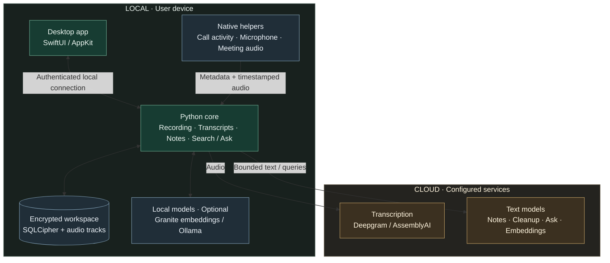
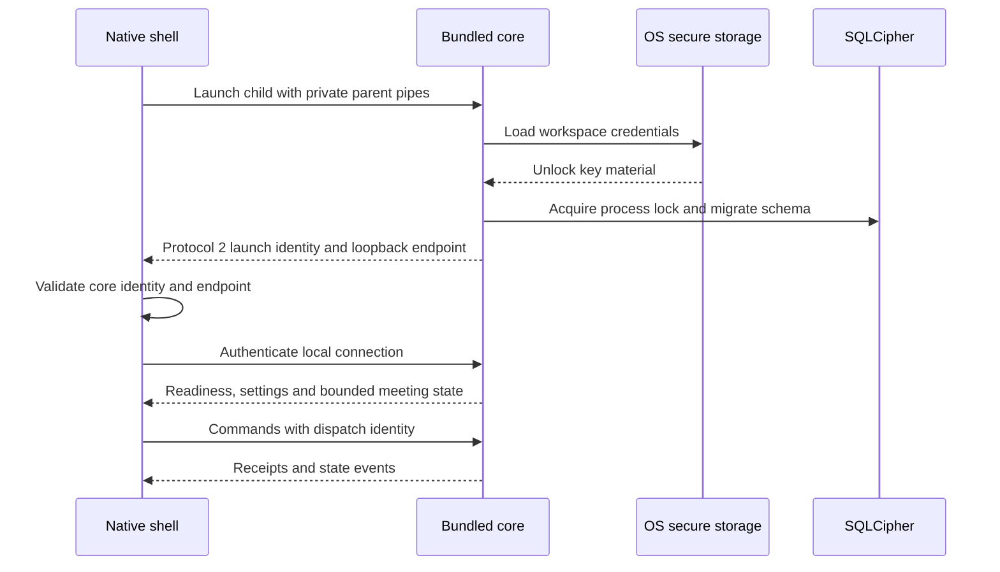
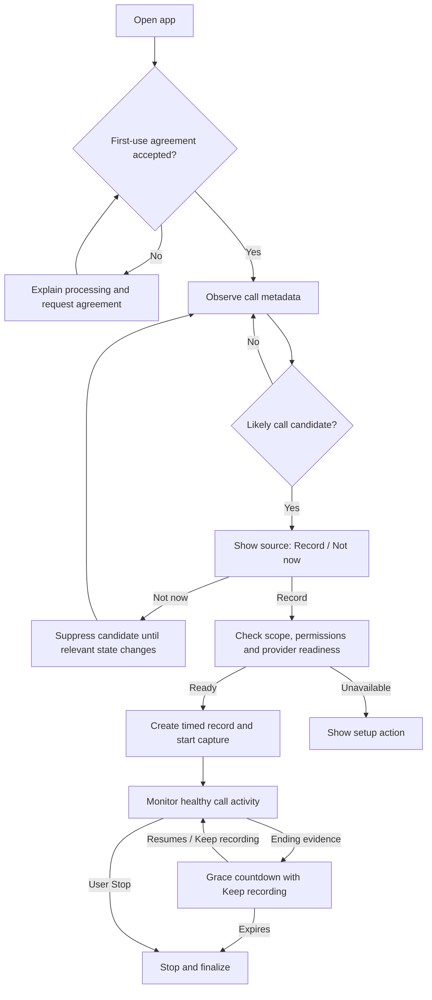
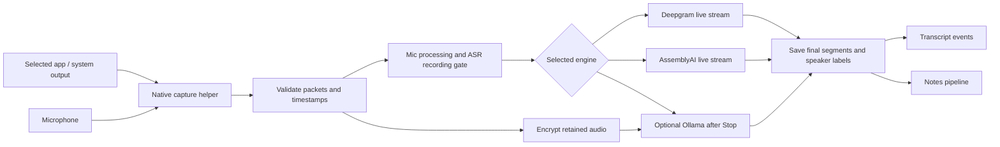
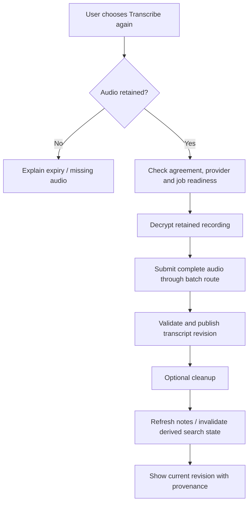
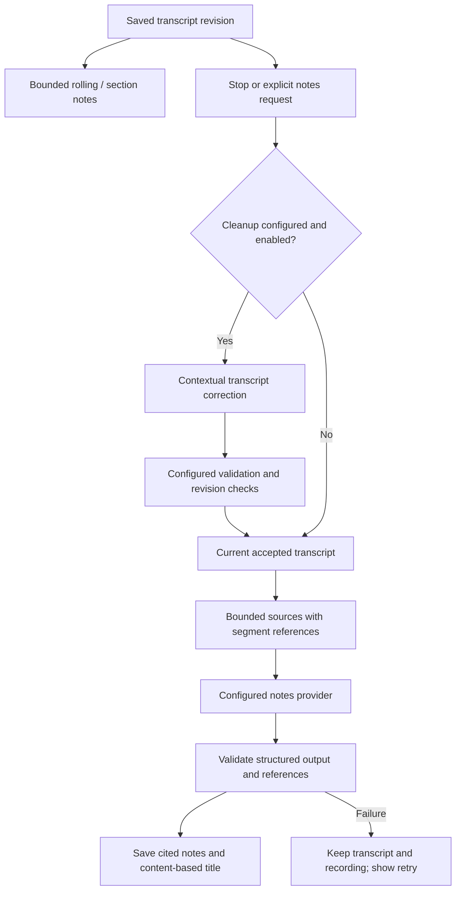
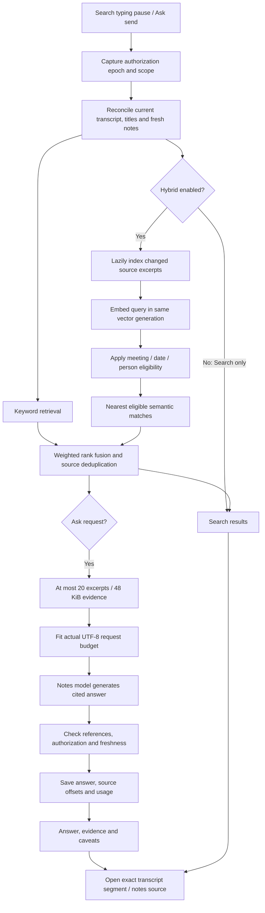
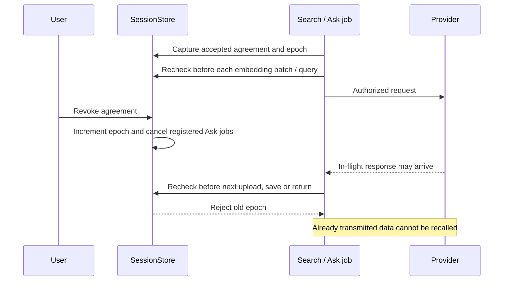
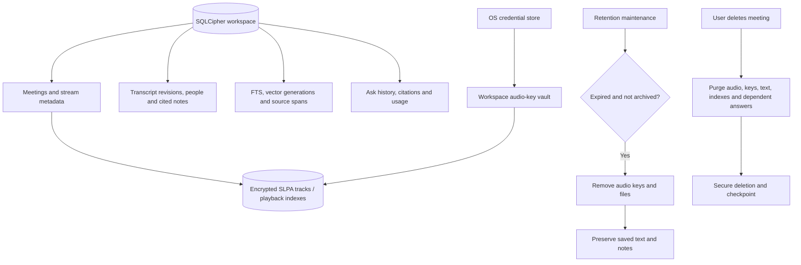

# ScribeLoop — Current architecture

Updated **12 November 2026** after the Search/Ask remediation and code cleanup.
This describes implemented behavior, not release acceptance. Historical research
and future work are linked separately below.

## 1. System map

ScribeLoop is a native meeting notebook: detect likely calls, offer **Record / Not
now**, retain encrypted audio and transcripts, generate cited notes, and retrieve
saved evidence through Search and Ask.

Apple Silicon macOS 13+ is the primary desktop target. Ubuntu has a GTK preview
sharing the Python core; capture and release parity remain separate acceptance
work. The browser UI is a development/demo client.

The core is the processing hub; arrows show data/request paths. Cloud use depends
on the selected providers. OS permissions, Keychain, Calendar and optional account
sign-in are described below rather than crowding this overview.

Defaults in [desktop_settings.py](core/scribeloop_core/api/desktop_settings.py):
Deepgram transcription, automatic notes enabled, OpenAI `gpt-5.4-mini` notes,
Keyword Search, and Gemini `gemini-embedding-001` at 768 dimensions when Hybrid
is enabled. Saved user preferences override defaults; cloud calls need credentials.

## 2. Component ownership

| Component          | Responsibility                                                                                | Source                                                                                                               |
| ------------------ | --------------------------------------------------------------------------------------------- | -------------------------------------------------------------------------------------------------------------------- |
| Native shell       | Window, Preferences, meeting selection, source navigation, playback and platform integrations | [shell/macos/Desktop](shell/macos/Desktop)                                                                            |
| Bootstrap/protocol | Child lifecycle, private handshake, authenticated commands and receipts                       | [desktop.py](core/scribeloop_core/api/desktop.py), [desktop_contract.py](core/scribeloop_core/api/desktop_contract.py) |
| API/settings       | Local HTTP/WebSocket transport, dispatch, provider configuration                              | [server.py](core/scribeloop_core/api/server.py), [desktop_settings.py](core/scribeloop_core/api/desktop_settings.py)   |
| Discovery          | Metadata observation, candidates and automatic end monitoring                                 | [meetings](core/scribeloop_core/meetings)                                                                             |
| Capture            | Native helpers, shared-clock streams, microphone processing and recording gates               | [capture](core/scribeloop_core/capture)                                                                               |
| Transcription      | Engine routing, cloud live streams, batch reruns and optional Ollama                          | [pipeline](core/scribeloop_core/pipeline)                                                                             |
| Notes/Ask          | Cleanup, bounded grounded notes, structured answers and provider adapters                     | [llm](core/scribeloop_core/llm)                                                                                       |
| Persistence        | Encryption, playback, retention, FTS, vector generations and answer history                   | [storage](core/scribeloop_core/storage)                                                                               |
| People             | Manual identities and separately gated calibration primitives                                 | [speakers](core/scribeloop_core/speakers)                                                                             |
| Packaging          | Frozen core, native helpers, assets and bundle verification                                   | [packaging/macos](packaging/macos)                                                                                    |

Python owns durable state and provider requests. Swift owns platform UI and native
integrations. Capture runs outside Python's interpreter. Research workers present
in the source tree do not imply production app routes.

## 3. Launch and local trust boundary

The app starts a bundled core, not the user's installed Python. Protocol 2 uses a
per-launch token and identity established through private pipes. The core binds
an ephemeral loopback endpoint. Production HTTP/WebSocket access is authenticated;
WebSockets validate Host/Origin and authenticate their first frame.

Reconnect reads current state and dispatch receipts instead of blindly replaying
uncertain mutations. The default workspace is
`~/Library/Application Support/ScribeLoop/meetings.sqlcipher`; a process lock
prevents concurrent owners. Secrets are excluded from public settings payloads.

Preferences edits are staged: Done saves, while Cancel/outside dismissal discards.
Provider/model/credential selections are retained independently where supported.
The development server's keyless same-origin loopback mode is distinct from the
authenticated native contract; it is not a remote deployment configuration.

## 4. First use and automatic call discovery

Agreement, OS permissions and the decision to record are independent gates.
Microphone, meeting-output capture and Calendar use separate permission handlers.
Already allowed permission controls are disabled. Ordinary restarts preserve grants;
development rebuild scripts intentionally reset relevant capture permission caches.

The macOS observer reads process/input/output activity metadata without opening an
audio capture stream. Detection uses activity evidence and candidate state; an open
Teams/Slack/browser app or chat notification alone is insufficient. Capturing a
browser captures that browser application's audio, potentially including other tabs.

Unknown/stale observer data does not prove that a call ended. The end monitor uses
recent healthy observations, app activity and optional microphone-release evidence.
Recording starts only after the user's Record choice. Manual recording is available.

Details: [detection](docs/MEETING_DETECTION.md),
[automatic-call UX](docs/AUTO_CALL_UX.md),
[first-use review](docs/FIRST_USE_UX_AUDIT_2026-11-09.md).

## 5. Audio capture and transcription

The implemented macOS helper uses ScreenCaptureKit output and AVFoundation
microphone capture. Core Audio process taps remain planned. Separate mic/output
streams share a clock and enter the core as bounded 16 kHz PCM packets.
Native helpers isolate capture from Python GC/GIL.

Deepgram is the default; AssemblyAI is another wired live/batch cloud route.
Automatic/fixed-language behavior is provider-specific. Speaker labels are
anonymous and provider/source scoped, not verified cross-meeting identities.
Users can map transcript labels to named people.

ASR silence/recording gates are separate from retained audio. Captured silence does
not imply transcript content. Failures are visible; providers are not automatically
switched. Stopping cloud streaming does not automatically rerun the entire recording.

Optional Ollama transcription processes saved audio. MOSS/GGUF and earlier
local-model experiments are research tooling, not the default desktop route.

### Manual batch rerun

Reruns do not simulate live streaming timing. Existing saved data remains available
when a job fails. Cloud streaming does not silently trigger a second full upload.

Details: [AssemblyAI](docs/ASSEMBLYAI_INTEGRATION.md),
[retained audio](docs/RETAINED_AUDIO.md),
[transcription controls](docs/TRANSCRIPTION_ACCURACY_CONTROLS_2026-10-30.md).

## 6. Cleanup, notes and saved-meeting actions

Cleanup and notes have independent provider/model settings. Presets supply endpoint
defaults; credentials belong to a provider/destination. OpenAI, Gemini, compatible
services, Ollama and LM Studio are supported through their corresponding adapters.
User instructions extend the populated default notes prompt.

Cleanup preserves provenance; it does not establish ground truth. Valid source IDs
also do not prove that generated prose is supported. Jobs use bounded inputs and
budgets without automatic paid retries or provider fallback.

Saved meetings offer a seekable audio playbar with speed control, transcript source
navigation, person naming, manual rename/delete, Markdown export, email handoff and
optional Calendar links. Calendar uses EventKit. Email handoff requires user action,
not an autonomous agent send.

Details: [summaries](docs/MEETING_SUMMARIES.md),
[cleanup](docs/LOCAL_TRANSCRIPT_CLEANUP_2026-11-05.md),
[Calendar](docs/MACOS_CALENDAR.md).

## 7. Search and Ask

Search returns matching saved sources. Ask uses retrieved context to generate a
structured cited answer. Ask requires configured Hybrid Search; weak retrieval
does not trigger a full-transcript upload.

The native Ask sheet has two entry points: Ask this meeting in a conversation and
Ask across meetings in the sidebar. A compact expandable context bar and Change
picker replace the scope tabs. Changing meetings starts a new chat; Cancel keeps
the current chat. History restores complete saved threads and their original
meeting context. Sources expand beneath each answer; processing details are hidden.
History supports confirmed deletion of a thread or all chats, cascading citations
and checkpointing the database without deleting meetings. Cached answers and old
history responses are invalidated. Deletion requires idle Ask jobs and makes no
provider or per-record Keychain request. Follow-ups
use the previous turn plus fresh evidence, not unlimited model memory.
Schema v22 adds thread/parent links; legacy answers become single-turn threads.
All-meeting membership freezes at the first question. Threads are capped at 100
answers and are purged when any scoped meeting is deleted. No-evidence replies
are saved too, without an answer-model call.
See [Ask UX flow and validation](docs/ASK_CHAT_UX.md).

Keyword Search is local. Hybrid can upload source excerpts and queries to the
chosen embedding service. Local embeddings avoid cloud embedding uploads; Ask may
still send evidence to a cloud notes provider.

Native Search runs automatically 500 ms after the last query/filter edit, in both
Keyword and Hybrid modes. There is no Search submit button. Pending edits coalesce
behind an in-flight request; obsolete results are hidden/discarded. Clearing the
field or closing Search clears its display without starting another provider call.

### Index identity and retrieval limits

- Providers: Gemini, OpenAI, bundled Local Granite, Ollama, LM Studio and Custom.
  Gemini defaults to 768 dimensions; bundled multilingual Granite uses 384.
- Generation identity includes provider, endpoint, model, dimensions, normalization
  and implementation version, excluding secrets. Different shapes/models are
  never compared in one vector space.
- Schema v21 stores exact source spans and cited excerpt offsets. Derived index
  version 4 uses 1,200-character source windows with 1,000-character stride.
  A late match reaches Ask as the matched excerpt rather than the parent prefix.
- Fusion favors semantic rank while retaining lexical evidence. Eligibility filters
  precede semantic top-k, so excluded results cannot crowd out eligible sources.
- Indexing is lazy and bounded; completed meeting indexes commit atomically.
  Semantic failures or budget exhaustion disclose keyword fallback. There is no
  hidden full-transcript fallback or automatic paid retry.
- Full canonical source hashes determine saved-answer freshness. History filters
  exact scope before its limit. Source navigation resolves the containing lazy
  transcript turn before scrolling and highlighting the cited segment.
- Actual serialized UTF-8 provider input, including schema/envelope, must fit the
  100,000-byte request budget. Lower-ranked evidence is removed when needed.

Nearest neighbors are not guaranteed relevant. The answer model must abstain when
evidence is insufficient. Citation membership validation is not an entailment check.

### Revocation and upload boundaries

Reaccepting cannot revive an old job. Guards also cover the Ollama
metadata-to-generation boundary and cancellation-resistant adapters. Production
dispatch supplies the authorization context; direct developer-library callers must
provide their own guard.

Metrics cover total processing, retrieval/indexing, embeddings and answer time,
model-call counts and input bytes. Answers persist usage. Legacy answers do not
present their generation-only timer as total processing time.

Implementation: [search.py](core/scribeloop_core/storage/search.py),
[vectors.py](core/scribeloop_core/storage/vectors.py),
[search_work.py](core/scribeloop_core/storage/search_work.py),
[meeting_ask.py](core/scribeloop_core/llm/meeting_ask.py).
See [remediation and measurements](docs/SEARCH_ASK_AUDIT_REMEDIATION.md)
and [Hybrid validation](docs/HYBRID_SEARCH_VALIDATION.md).

## 8. Storage, retention and deletion

Production uses one SQLCipher workspace for meetings, transcript revisions, people,
summaries, jobs, FTS, vector metadata and Ask history. The authoritative schema is
[db.py](core/scribeloop_core/storage/db.py), currently version 22; executable DDL
is not duplicated here. Vectors share the encrypted workspace rather than a
plaintext external index.

Audio retention defaults to 30 days; archive preserves audio beyond that period.
Expiry differs from meeting deletion. Deleting a meeting purges every vector
generation, not only the selected one. Person forgetting invalidates applicable
derived data.

Playback decrypts bounded retained-audio reads without an ASR request. Workspace
key caching avoids repeatedly reading individual recording keys from native
Keychain. Rebuild/signing identity changes can still prompt macOS for access;
ScribeLoop cannot bypass SecurityAgent approval.

Details: [secure storage](docs/SECURE_STORAGE.md),
[retained audio](docs/RETAINED_AUDIO.md),
[memory cache](docs/MEMORY_CACHE_256MB.md).

## 9. Accounts, shutdown and distribution

Optional account sign-in uses browser OAuth/PKCE, loopback callback and signed
entitlements. Refresh credentials use OS secure storage. Account changes are blocked
during active capture/processing. Checkout and paid-feature enforcement are not
shipped. See [accounts](docs/GOOGLE_ACCOUNT_IMPLEMENTATION.md).

Shutdown stops discovery/capture, drains recording, cancels pending processing,
releases local resources/unlocked keys and closes the workspace. Interrupted
mutations are not silently replayed on launch.

The macOS bundle contains the frozen core, native helpers and bundled local
embedding assets. It needs neither a checkout nor Homebrew Python and does not
download embedding weights at runtime. Internal builds are ad-hoc signed.
Developer ID signing/notarization and clean-machine/upgrade acceptance remain open.
See [desktop build instructions](packaging/macos/DESKTOP.md) and
[Ubuntu preview](docs/LINUX_UBUNTU_PREVIEW.md).

## 10. Validation boundaries and historical plans

The cleanup passed 882 automated tests without changing retrieval scores.
The versioned local synthetic evaluation achieved 95% top-five and 97.5% top-20
supporting-passage recall for both Search and Ask. These small in-memory local-model
measurements are not Gemini accuracy or production-scale performance guarantees.
Real Gemini and source-navigation checks are recorded in the
[remediation report](docs/SEARCH_ASK_AUDIT_REMEDIATION.md).

Release acceptance still requires:

- Independent answer-grounding and unsupported-answer evaluation.
- Encrypted production-scale indexing/search latency and memory measurements.
- Controlled physical audio/timing and broader real-call/platform checks.
- Distribution signing/notarization and clean-machine/upgrade validation.
- Validated calibration before automatic cross-meeting voice recognition.

Embedded GPU workers, MOSS/Whisper bake-offs, automatic two-pass ASR, pyannote research
and future autonomous agent actions are not current defaults. Their rationale lives
in [Phase 0](docs/PHASE_0_CLOSEOUT.md),
[ASR investigation](docs/ASR_INVESTIGATION.md) and
[MOSS evaluation](docs/MOSS_EVALUATION.md). Agent modules are scaffolding, not a
shipped autonomous action system.

For delivery scope and acceptance, see [current status](docs/CURRENT_STATUS.md),
[Phase 2b closeout](docs/PHASE_2B_CLOSEOUT.md) and
[workspace delivery plan](docs/MEETING_WORKSPACE_DELIVERY_PLAN.md).
