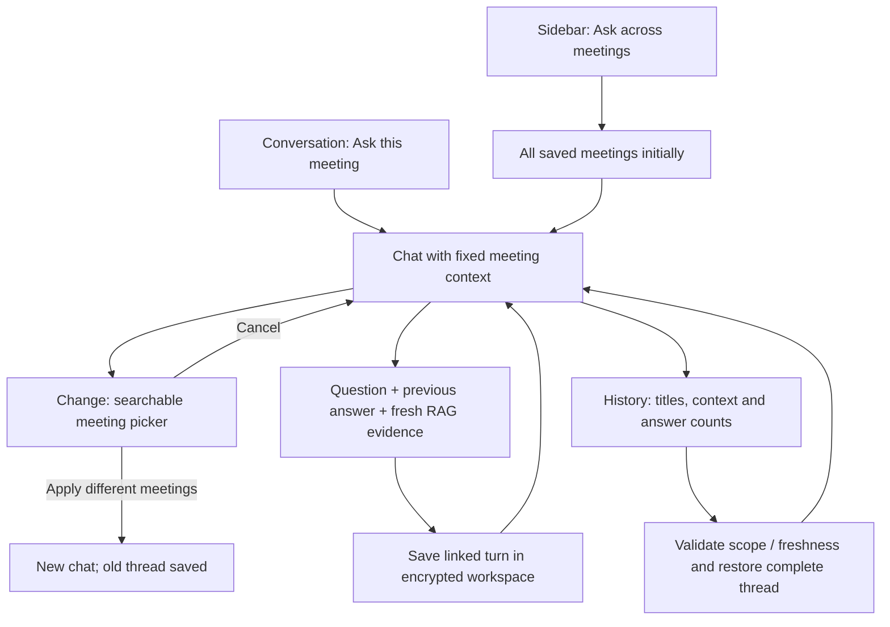

# Ask chat experience

## Intended flow

Open Ask this meeting from a conversation, or Ask across meetings from the sidebar
→ send a question → read the cited answer →
continue with a follow-up, inspect a source, or start a new chat.

Use the notebook palette, a chronological message timeline, an anchored multiline
composer, starter questions and a separate saved-answer history panel. Keep sources
and processing details collapsed beneath each answer. Never make provider calls on
opening Ask, choosing a starter, changing scope or reopening a saved answer.

One compact context bar replaces the three-way scope tabs. Click its title/count
to inspect included meetings. Change opens the searchable checkmark picker; Apply
starts a new chat if the selection changed, while Cancel leaves the chat intact.
All saved meetings is an explicit alternative in that picker.

Scope changes start a fresh visible chat. History lists saved threads with a title,
meeting context, timestamp and answer count. Selecting a thread restores its whole
bounded exchange and original scope. Following a source and reopening Ask resumes
the saved thread. Follow-ups still use the previous turn and freshly retrieved
evidence, not unlimited model memory.

Schema v22 stores thread and parent-answer IDs. Legacy answers become individual
threads because their earlier relationships were not stored. Each thread is capped
at 100 saved answers. No-evidence refusals are saved without an answer-model call,
so those turns also survive reopening. All-meeting chat membership freezes at the
first question; new meetings do not silently broaden a follow-up. Selected scope
remains limited to 100 meetings; internal frozen all-meeting scope permits 10,000.
Meeting deletion purges every thread containing that meeting, including refusals
without citations. Opening history does not call embedding or answer providers.

## Finish conditions

- Questions and answers remain visible in chronological order during the chat.
- Follow-ups work without a separate Follow up button.
- Send rejects blank, oversized or scope-less input; loading supports cancellation.
- Failed requests retain editable question text for explicit retry.
- New chat and scope changes clear follow-up context; in-flight requests cannot
  be accidentally attached to another visible conversation.
- Saved answers, stale-state warnings, source links, caveats and usage remain
  accessible without dominating the message timeline.
- Native compilation succeeds; permission and provider authorization stay in the
  existing core. UI-only checks need no paid API requests.

## Earlier timeline redesign verification — 12 November 2026

- Native Swift typecheck passed. The existing macOS 13-compatible change handlers
  produce SDK deprecation warnings on newer SDKs.
- An isolated native preview with synthetic data and a fake dispatch adapter
  verified starter selection, sending two chronological turns, follow-up composer,
  expanded source text, New chat, scope switching and the history panel. It did
  not start the core, open the user's workspace or make provider requests.
- The preview exposed retained scroll position after New chat; the production
  view now explicitly scrolls to the top when the timeline is cleared.
- All 29 existing Ask/remediation regression tests passed. The RAG backend,
  provider contracts, authorization guards and schema are unchanged.
- The macOS app was rebuilt at `dist/macos/ScribeLoop.app`; bundle verification
  passed (40 native binaries, no external dependencies, no bundled recordings or
  operator transcription credential, macOS 13 target, internal ad-hoc signing).

The redesigned composer supports multiple lines, a 500-character question limit,
Send and Command-Return. While processing it disables scope changes and offers
Stop; failure restores the submitted text for editing. Cancellation/failure UI
behavior is implemented but was not exercised in the synthetic desktop walkthrough.
History continues to use backend source-freshness validation.

## Meeting context and durable threads — 12 November 2026

Implemented on `feature/ask-meeting-context-and-threads`:

- Separate conversation and sidebar entry points; compact expandable context bar,
  searchable meeting selection, Cancel/Apply and an All saved meetings option.
- Complete linked thread restore, context restore, resume after cited navigation,
  saved no-evidence turns, legacy single-turn migration and a 100-answer cap.
- Explicit frozen all-meeting membership is applied before lexical and semantic
  selection. Selected-meeting requests keep the 100-meeting limit; internal
  all-meeting snapshots permit up to 10,000 IDs.
- Stale threads show a warning and disable follow-ups until a new chat is started.
  Thread reads use the existing agreement epoch and do not call AI providers.
- Ten added automated tests cover durable reopen, scope isolation/freshness,
  frozen membership, refusals/deletion, thread limits, revocation, v21 migration,
  all-scope over 100 meetings, native history/restore dispatch and an in-flight
  deletion race. A reply cannot recreate a deleted chat or save against a deleted
  meeting. All 892 tests
  pass; changed Python files pass Ruff and whitespace checks.
- The final macOS app was rebuilt at `dist/macos/ScribeLoop.app` and passes bundle
  verification: 40 native binaries, no external dependencies, no bundled recordings
  or operator transcription key, macOS 13 minimum, internal ad-hoc signing.

The final native UI walkthrough is **not verified**: desktop-control startup
failed repeatedly with `Sky Computer Use native pipe startup failed`, including
after resetting the connection. An isolated synthetic context-preview executable
compiled successfully, but it could not be opened/inspected with that tool.
The earlier timeline screenshots above do not validate this later context change.
