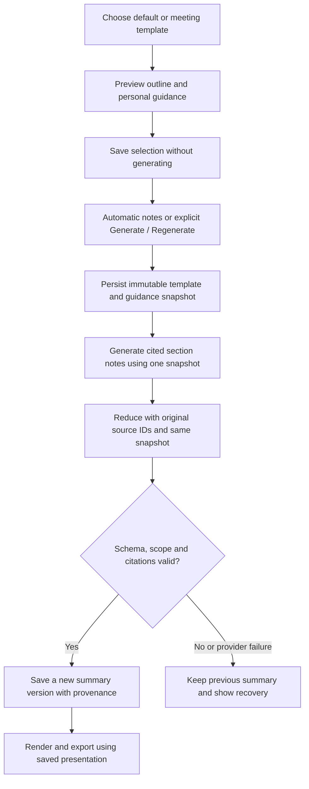
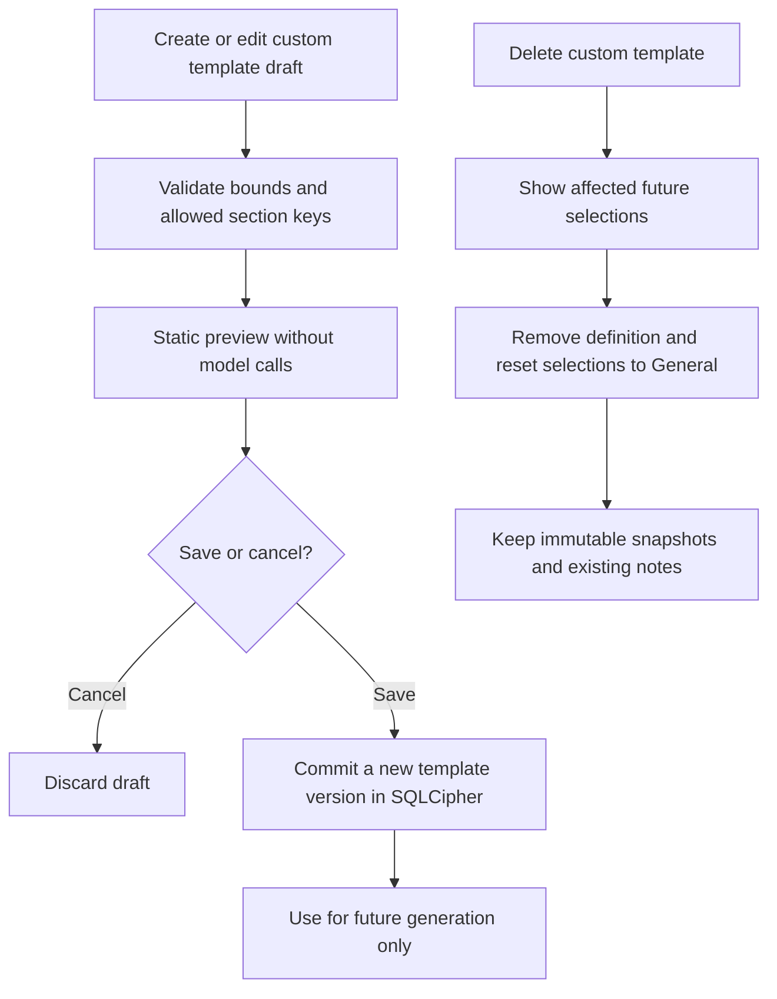

# F3 — Meeting templates: implementation preparation

Prepared 16 November 2026 against main `71b6f59`.
Status: **slice 1 complete on 17 November 2026; slice 2 implemented; slices 3–5 pending**.
F1/F2 are closed by user approval. Their accepted validation follow-ups do not
block F3. Requirements remain in [the delivery plan](MEETING_WORKSPACE_DELIVERY_PLAN.md#f3--meeting-templates).

## Outcome and boundaries

Choose General, Stand-up, Customer call, Interview, Planning or One-to-one notes
without writing a prompt. Provide a default, a per-meeting choice and editable
custom templates. Preserve personal summary instructions as a separate layer.
Changing any choice affects future generation only; existing notes retain their
original format, provenance and citations until explicit regeneration succeeds.

Reuse the existing structured cited-summary pipeline, not a second summarizer.
Keep provider/model selection in Models. Templates do not change ASR, speaker
attribution, provider destinations, permissions, consent or upload behavior.
F3 does not introduce an action tracker, arbitrary model schemas, an AI-generated
template designer or new external integrations.

## Code findings and proposed changes

| Area | Existing implementation | F3 change |
| --- | --- | --- |
| Prompt and citation contract | `llm/grounded.py`, `llm/schemas.py` | Add validated template focus and presentation metadata; preserve schema/citation rules |
| Long-meeting notes | `llm/rolling.py` sections and recursive reduction | Carry one immutable template/guidance snapshot through every section and reduction |
| Automatic/manual generation | `api/server.py` automatic jobs and summarize command | Resolve and persist the snapshot before dispatch; use it for the entire generation |
| Saved summaries | `storage/sessions.py`, schema 23 in `storage/db.py` | Add template library, workspace default, meeting selection and generation provenance in schema 24 |
| Provider/personal settings | `api/desktop_settings.py`, `Preferences.swift` | Preserve `summary_instructions` exactly; expose it separately from template focus |
| Native notes | `CitedNotes`, fixed section headings in `DesktopApp.swift` | Render saved section order/labels, template badge and generation preview |
| Exports | `llm/grounded.py`, `api/email_exports.py` | Use saved template presentation in Markdown and email; keep source links and escaping |
| Search/Ask | Current-summary text and source fingerprints | Keep indexing canonical summary content; no separate template text as factual evidence |

### Template contract

- Stable ID, name, integer version, bounded focus instructions, and validated
  ordering/labels for existing cited-summary sections. Built-ins have reserved IDs;
  editing one creates a custom copy.
- Keep the canonical `GroundedSummary` fields. Templates focus, reorder and label
  those fields; they cannot introduce arbitrary JSON properties or disable citation,
  owner/date, uncertainty or source-scope validation.
- Overview remains present. Preserve decisions, actions and uncertainties whenever
  supported, even if a custom layout would otherwise omit them. Empty optional
  sections remain hidden. Avoid forced filler and claims that a field was discussed
  merely because the template asks for it.
- Initial bounds: 50 custom templates, names 1–80 characters, focus ≤2,000 Unicode
  code points, valid unique section keys, labels 1–80 characters. Enforce server-side
  bounds before save; snapshots also remain subject to existing provider byte limits.
- Templates are optional presentation/preferences, lower priority than factual and
  citation rules. Reject malformed definitions; treat transcript content as data.

| Built-in | Focus and presentation intent |
| --- | --- |
| General | Overview, key points, decisions, actions, questions, uncertainty |
| Stand-up | Updates/blockers, decisions and explicit next steps; no inferred progress |
| Customer call | Customer needs, commitments and next steps; no invented budget or owner |
| Interview | Discussion themes and stated evidence; no inferred hiring verdict |
| Planning | Proposals versus approved decisions, dependencies and assigned actions |
| One-to-one | Discussion themes, agreed follow-ups and open questions; no inferred sentiment |

Each built-in still uses the same canonical fact/citation types. Product copy and
fixture results must not imply that custom labels create new semantic fields.

### Storage and immutable generation snapshot

Use the encrypted workspace for custom definitions, workspace default and meeting
choices; template edits must not trigger Keychain writes. Keep credential storage
and the existing personal instructions unchanged.

At new-meeting creation, attach the current default template ID without adding a
recording dialog. Existing meetings migrate to General. A per-meeting choice
overrides the attached choice and persists across reopen.

Immediately before generation starts, resolve and persist:

- Template ID/version/name, complete validated definition and definition hash.
- A generation ID. Explicit Regenerate starts a new generation rather than silently
  reusing the previous completed result; recovery may reuse nodes only within the
  same generation/snapshot.
- Exact personal instructions, presentation contract version and output-language
  policy. Keep the existing conversation-language behavior unless guidance explicitly
  asks for another language; use localized built-in labels for English/Vietnamese.
- Source revision, per-node content identities and provider/model/public destination metadata.
  Never persist an API key in the snapshot.

For live rolling notes, create the snapshot at the first actual notes dispatch and
reuse that generation through final reduction; stopping the recording must not
resolve a different template for already generated sections. Bind the final saved
summary to the completed transcript's content hash when it is finalized.

Bind every section/reduction cache key and saved final version to that snapshot.
Do not reread mutable settings or the template library between provider calls.
Changing a template or guidance must not reuse old-format cached nodes. Preserve
the existing cumulative provider budget and unknown-delivery/no-blind-retry rules.

Built-in upgrades, custom edits and deletion cannot mutate saved snapshots.
Deleting a custom template resets its future default/meeting selections to General
in one transaction, reports affected selections, and preserves already generated
notes. Do not silently call an LLM or present retained notes as regenerated.
Legacy summaries retain their current rendering and a clear legacy/General label;
do not invent a historical generation snapshot.

## Native UX

- Add a Notes page to Preferences: default template picker, short outline preview,
  custom-template controls and a separate Personal guidance editor. Leave provider
  endpoint/model/key controls in Models.
- All Preferences changes remain local drafts until Done. Cancel/outside dismissal
  discards them. Extend `PreferencesSaveProgress` for template persistence and show
  exactly what saved if a later save step fails; Keychain and SQLCipher writes are
  separate resources and must not be falsely described as one atomic transaction.
- In a meeting's Notes header, show a compact template picker and Preview. Explain
  “Applies to the next notes generation.” If saved notes used another template,
  show their original badge and a distinct Regenerate action.
- Preview is a static outline with effective template, guidance and provider
  destination. It never calls an API or fabricates sample meeting facts.
- Create/edit custom templates in a compact draft editor with bounded fields,
  section controls, inline validation, Save and Cancel. Copy built-ins rather than
  editing them in place. Explain deletion's future-selection effect before applying it.
- While generating, show the snapshotted template and progress. Preserve the last
  saved notes on failure/cancellation. New settings may be drafted for later;
  they cannot alter an active request.
- Use the notebook palette, native keyboard/focus behavior and existing accessible
  control patterns. No extra first-use agreement or per-recording checkbox.

## Implementation slices and finish conditions

| Slice | Deliverable | Finished when |
| --- | --- | --- |
| 1. Contracts/storage | Six built-ins, bounded definitions, migration, default/meeting selection and CRUD | Populated schema-23 upgrade preserves notes/guidance/keys; reopen and deletion/version tests pass |
| 2. Generation integration | Immutable snapshot for automatic, manual, rolling and reduction paths | Mid-generation edits cannot change output policy; cache isolation, byte budgets and failure-preserves-old-version tests pass |
| 3. Native selection/editor | Notes preferences page, meeting picker, static preview and custom editor | Complete default/create/edit/cancel/delete/override flows work with keyboard; preview/selection make zero provider requests |
| 4. Presentation/exports | Saved-template rendering, provenance, Markdown and email headings | English/Vietnamese notes, citations and exports agree; deleting/editing a template cannot alter a saved version |
| 5. Audit/closeout | Representative fixtures, guarded live validation, app rebuild and finish report | Six templates and negative cases reviewed, required CI green, native UI matrix recorded; any unrun check is explicit |

Tests must cover ordinary short notes and multi-section reduction, all six
built-ins, unsupported facts, unknown citations, hostile template instructions,
source edits, deleted custom templates, revision changes, provider errors, budget
limits and populated-workspace migration. Use fake providers first. Live calls
remain explicit; Gemini's known quota limit is not a reason for automatic fallback
or repeated retries. Human review distinguishes desired formatting from factual
grounding. Prepare `TEMPLATES_CLOSEOUT.md` with measured evidence before closing F3.

## First implementation step

Created `feature/f3-meeting-templates` from `feature/transcript-auto-loading`
(`240e35d`) so the approved transcript improvements remain available. This is a
stacked branch; merge the transcript fixes before the F3 PR. Implement slice 1 with a
small dedicated template domain/storage module and schema-24 migration. Keep the
existing notes behavior intact until slice 2 integrates the validated snapshot.
Do not start with the picker alone or replace personal instructions with defaults.

## Slice 1 implementation record — 17 November 2026

- Added `llm/note_templates.py`: six built-ins, strict bounded definitions,
  English/Vietnamese section labels, deterministic definition hashes and canonical
  section preservation. A custom outline cannot hide supported factual sections.
- Schema 24 adds the template library, singleton workspace default, per-meeting
  selection and immutable generation policies. Existing meetings attach General;
  new recordings snapshot the current default in their creation transaction.
- `storage/note_templates.py` supports validated CRUD, a database-enforced 50-custom
  limit, optimistic version checks, persisted choices and atomic deletion/reset.
  Deletion preserves generation snapshots and existing notes. Meeting deletion
  cascades through its selection and policy records.
- Generation policy creation records a unique ID, source revision, full definition,
  version/hash, exact guidance, presentation/language policy and public destination.
  Credential-bearing/query URLs are rejected; no API-key field is accepted.
  Policies are immutable in SQL. Generation dispatch is **not yet wired** to these
  records, so active summary behavior and existing personal instructions stay intact.
- Focused regressions cover populated v23 migration/idempotence, transaction rollback,
  reopened choices, English/Vietnamese presentation, bounds, immutable policies,
  edit/delete persistence and real SQLCipher reopen/encryption. No provider calls.

Next: slice 2, carrying one policy through automatic/manual notes, rolling sections
and reductions, with generation-specific cache identities and saved provenance.
Do not expose an operational template picker until generation uses the snapshot.

Verification: **1,007 passed, 1 skipped** in the complete Python suite (39.42 s),
including 22 new template cases. Ruff and whitespace checks pass. The first full
attempt needed the already-declared `defusedxml` dependency installed locally;
a sandboxed run also blocked localhost OAuth callbacks and native audio conversion.
The final run with local helper access passed. No live API validation or native
F3 UI acceptance is claimed for this storage-only slice.

### Slice 2 integration decisions

Schema 25 adds generation references to jobs/final summaries and a separate mutable
run-state table; immutable policy records are never updated. Explicit Generate
starts a new generation. Rolling sections reuse one persisted generation through
final reduction, including failed-dispatch state, so fresh audio cannot trigger a
blind retry. The request captures provider configuration and personal guidance
before task scheduling. Every node cache key includes the generation ID; all
existing citation validation, cumulative budget and previous-summary preservation
remain mandatory. Legacy callers without a generation retain their old read/cache
contract; production notes dispatch always resolves a generation.

## Slice 2 implementation record — 17 November 2026

- All production notes entry points now resolve `NotesGeneration` before task
  scheduling, capturing provider configuration in memory and policy in SQLCipher.
  API keys remain solely in the in-memory provider. Personal guidance/template
  edits after dispatch cannot change subsequent sections or reductions.
- Schema 25 links jobs and saved summaries to generation IDs, with separate run
  state. Cache recovery stays within a generation; explicit Generate always starts
  a fresh generation, including when template/guidance are unchanged. Previously
  failed rolling dispatches remain blocked until explicit regeneration.
- No snapshot is created for live notes until a closed section can be dispatched.
  The same live policy reaches final reduction. If cleanup creates a replacement
  transcript revision, a separate, one-time final-revision admission binds final
  jobs and saved content hashes to that source without mutating editorial policy.
- Template focus/labels are lower-priority editorial preferences in every section
  and reduction request. Canonical schema/citation validation remains mandatory;
  unsupported sections cannot gain invented content merely to fill a layout.
- Provider input accounting uses the actual serialized provider body where
  available. Consent-epoch checks run at node boundaries and immediately before
  real provider HTTP dispatch, including after local metadata awaits. Revoking and
  reaccepting the agreement cannot restore an old run's authority.
- Successful final notes persist provenance and mark the generation completed in
  the same transaction. Failure preserves the last saved version. A late
  cancellation after commit cannot relabel a completed generation as failed.
- Legacy summaries retain no fabricated provenance. Legacy low-level rolling-note
  callers keep their existing cache contract; production dispatch always uses a
  generation. Current summary rendering and exports are still the legacy layout.

Verification: focused fake-provider/API tests cover six built-ins, section and
reduction propagation, mid-run edits, cache isolation/recovery, rolling-to-final
reuse, cleanup revisions, changed destination/source refusal, hostile template
output, byte budgets, revoked authorization, migration, two explicit API-generated
versions and failure preserving the prior version. Complete suite: **1,023 passed,
1 skipped** (40.25 s); follow-up focused checks cover final lifecycle/source guards.
No live provider calls, native F3 UI acceptance or formatting-quality score claimed.

Next: slice 3, backend template commands and the native Notes preferences page,
meeting selection, static preview and custom-template draft editor. Slice 4 must
then render/export saved presentation, followed by F3 acceptance in slice 5.
