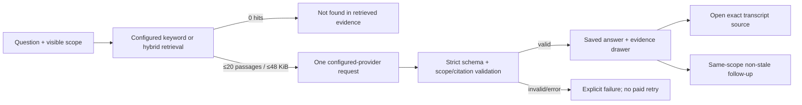

# F2 Ask meetings — implementation closeout

Status: Ask implementation complete; release acceptance evaluation remains open.
Updated 2026-11-16. See `HYBRID_SEARCH_VALIDATION.md`, `SEARCH_CLOSEOUT.md` and
the acceptance artifacts below. Earlier test counts in this document are historical.

## Delivered flow

The native Ask sheet offers current, explicitly chosen, or all-meeting scope. The
server resolves and enforces that scope, reconciles the encrypted F1 index, removes
common English/Vietnamese question words, and ranks current-revision transcript and
grounded-summary passages. Titles can aid search but are excluded as factual Ask
evidence. Retrieval is limited to 20 passages and 48 KiB and discloses truncation.

One bounded evidence packet is sent to the configured notes provider. A strict JSON
schema limits output to 2,000 tokens and requires every rendered claim to use an
allowed citation ID and identify itself as a decision, proposal, fact, conflict or
uncertainty. Unknown or out-of-scope citations reject the entire answer. Questions,
transcripts and prior answers are explicitly treated as untrusted data. Ask has no
tools, cannot send messages and never uploads audio.

Successful answers are saved in the SQLCipher workspace with exact scope, provider,
model, evidence identities and content hashes. Transcript edits or selected-revision
changes mark affected answers outdated. Deleting any cited meeting purges the
dependent answer. Follow-ups require the exact same scope and a non-stale prior
answer. Provider errors and cancellation preserve earlier answers and never retry
automatically.

UX/lifecycle audit (2026-11-10): saved-answer fingerprints now cover every
provider-visible source field, so speaker-name and meeting-title changes invalidate
answers as well as transcript edits. Saved questions reopen their complete answer
and evidence instead of acting only as follow-up shortcuts. The native sheet shows
the active scope, uses a vertically scannable meeting chooser, exposes follow-up
context and cancellation, and clears results when scope or sheet context changes.
F1 Search clearing now invalidates its outstanding request so a late response cannot
repopulate a cleared field; title hits consistently open the transcript view.



## Storage and rollback

Schema v17 adds `meeting_answers`, normalized `meeting_answer_sources`, and a
before-delete purge trigger. Schema v18 adds request duration and input/output byte
measurements. Both are additive. Rolling back the application leaves the new tables
unused; rolling forward preserves them. No existing meeting, credential, audio,
transcript or summary row is rewritten.

Schema v19/v20 adds vector-generation identities and per-meeting semantic index
state. These additive indexes are derived from current transcript/summary sources.
Settings chooses local or remote embeddings independently from the notes provider.

## Verification recorded

- 841 Python tests passed on the development Mac.
- Full nine-source native Swift build compiled for arm64 macOS 13.
- Focused Ask/search/desktop/provider tests cover scope isolation, byte/passage
  limits, insufficient evidence, invalid citations, prompt-injection boundaries,
  stale transcript edits and deletion purge.
- Each successful answer records one request, provider/model, elapsed milliseconds,
  input bytes, output bytes and the 2,000-token output ceiling.

## Open release gates

Implementation completion is not the same as F2 release acceptance. The versioned
30-meeting/40-question corpus and independent human review still need to be run
three times with the chosen production model. The required report must separately
score citation existence and semantic support, reach at least 90% grounding on
answerable questions, and confirm all ten unanswerable/conflicting cases avoid
invented certainty. Installed-app keyboard, long Vietnamese text, physical
citation navigation, cancellation timing, offline/quota recovery and first-status
under one second also require final hands-on evidence.

## Acceptance attempt — 2026-11-16

The versioned fixture is `tests/fixtures/meeting_workspace_acceptance_v1.json`:
30 synthetic meetings, 10 recurring topics, English/Vietnamese/code switching,
repeated titles, amended proposals, conflicting deadlines, unclear speech and
missing facts. It contains 30 answerable and 10 unanswerable/conflicting questions,
with expected facts and forbidden conclusions frozen before model execution.
The seeder applies speaker labels and a deleted-meeting canary; there is no audio.
Its labels are developer-authored and still need independent human review.

The runner uses a temporary SQLCipher workspace, the app's saved provider choices,
no user conversations/audio, no automatic retries, at most 420 provider calls and
5 MB aggregate counted input. The envelope sizes of answers are counted; embedding
input accounting counts text bytes rather than complete HTTP envelope bytes.
Results checkpoint after every case, and provider/quota failures stop the run.

Saved destination: Gemini `gemini-3.5-flash-lite` answers with
`gemini-embedding-001`, 768 dimensions. The first attempt stopped after 15 cases
and 75 counted calls on **HTTP 429**. A harness metadata-wrapper error affected
earlier cases; this wrapper was subsequently fixed and verified with a real Ask
persistence path and fake providers. **This attempt is invalid for model quality.**
There are no three completed passes and no human-grounding score. No live retry
was made after the quota response.

Artifacts:

- [Partial attempt, failures and configuration](acceptance/2026-11-16/live-attempt-blocked.json)
- [120-row human-review template](acceptance/2026-11-16/human-review-template.csv)
- [Encrypted F1 performance results](acceptance/2026-11-16/encrypted-scale.json)
- [Local retrieval summary](acceptance/2026-11-16/local-retrieval-summary.json)

After quota is resolved and fixture labels reviewed, explicitly run:

```sh
PYTHONPATH=core .venv/bin/python scripts/evaluate_meeting_workspace.py \
  --allow-cloud --runs 3 --output-dir data/validation/f1-f2/new-production-attempt
```

Use a new output directory so previous attempts are preserved. The resulting
`human-review.csv` pairs answers and citations with the frozen expected facts.
A reviewer must independently score semantic support and all negative/conflicting
cases. Citation-ID validity is reported separately and is not a grounding score.
Do not mark F2 release accepted until all three passes and the native recovery/
status-timing checks satisfy the delivery plan.
