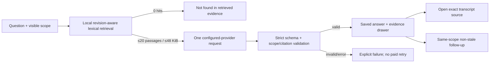

# F2 Ask meetings — implementation closeout

Status: implementation complete on `feature/f2-ask-meetings`; release acceptance
evaluation remains open. Updated 2026-11-10.

## Delivered flow

The native Ask sheet offers current, explicitly chosen, or all-meeting scope. The
server resolves and enforces that scope, reconciles the encrypted F1 index, removes
common English/Vietnamese question words, and ranks current-revision transcript and
grounded-summary passages. Titles can aid search but are excluded as factual Ask
evidence. Retrieval is limited to 20 passages and 48 KiB and discloses truncation.

One bounded evidence packet is sent to the configured notes provider. A strict JSON
schema limits output to 2,000 tokens and requires every rendered claim to use an
allowed citation ID and identify itself as a decision, proposal, fact, conflict or
uncertainty. Unknown or out-of-scope citations reject the entire answer. Questions,
transcripts and prior answers are explicitly treated as untrusted data. Ask has no
tools, cannot send messages and never uploads audio.

Successful answers are saved in the SQLCipher workspace with exact scope, provider,
model, evidence identities and content hashes. Transcript edits or selected-revision
changes mark affected answers outdated. Deleting any cited meeting purges the
dependent answer. Follow-ups require the exact same scope and a non-stale prior
answer. Provider errors and cancellation preserve earlier answers and never retry
automatically.

## Storage and rollback

Schema v17 adds `meeting_answers`, normalized `meeting_answer_sources`, and a
before-delete purge trigger. Schema v18 adds request duration and input/output byte
measurements. Both are additive. Rolling back the application leaves the new tables
unused; rolling forward preserves them. No existing meeting, credential, audio,
transcript or summary row is rewritten.

## Verification recorded

- 841 Python tests passed on the development Mac.
- Full nine-source native Swift build compiled for arm64 macOS 13.
- Focused Ask/search/desktop/provider tests cover scope isolation, byte/passage
  limits, insufficient evidence, invalid citations, prompt-injection boundaries,
  stale transcript edits and deletion purge.
- Each successful answer records one request, provider/model, elapsed milliseconds,
  input bytes, output bytes and the 2,000-token output ceiling.

## Open release gates

Implementation completion is not the same as F2 release acceptance. The versioned
30-meeting/40-question corpus and independent human review still need to be run
three times with the chosen production model. The required report must separately
score citation existence and semantic support, reach at least 90% grounding on
answerable questions, and confirm all ten unanswerable/conflicting cases avoid
invented certainty. Installed-app keyboard, long Vietnamese text, physical
citation navigation, cancellation timing, offline/quota recovery and first-status
under one second also require final hands-on evidence.
