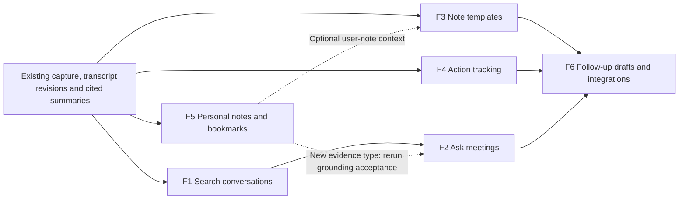
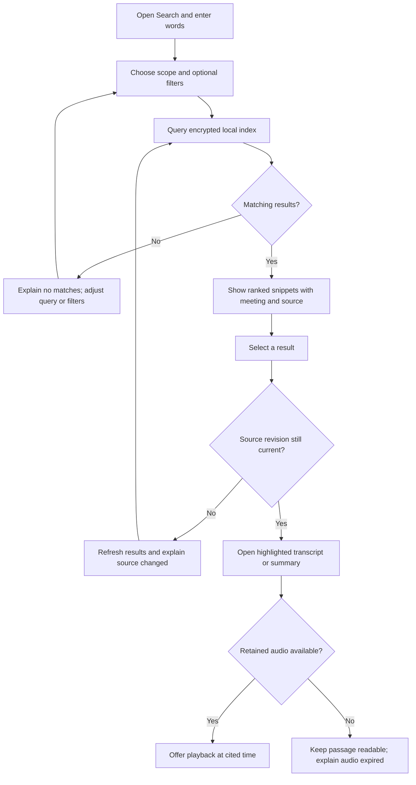
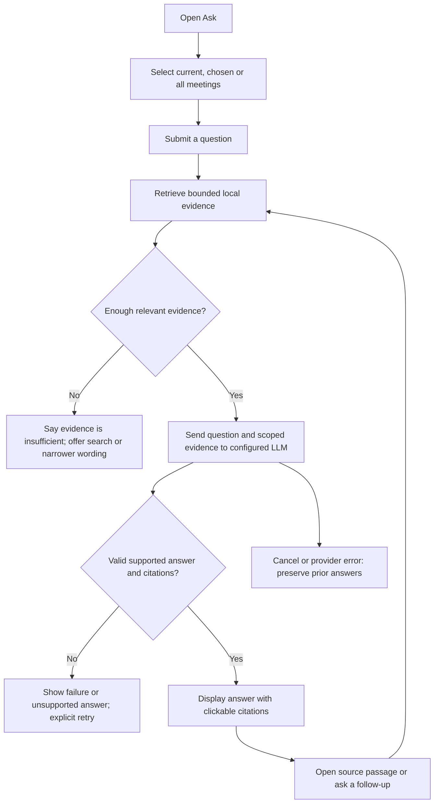
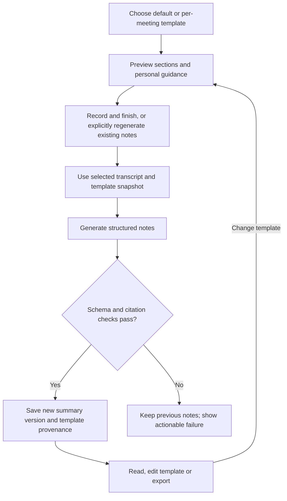
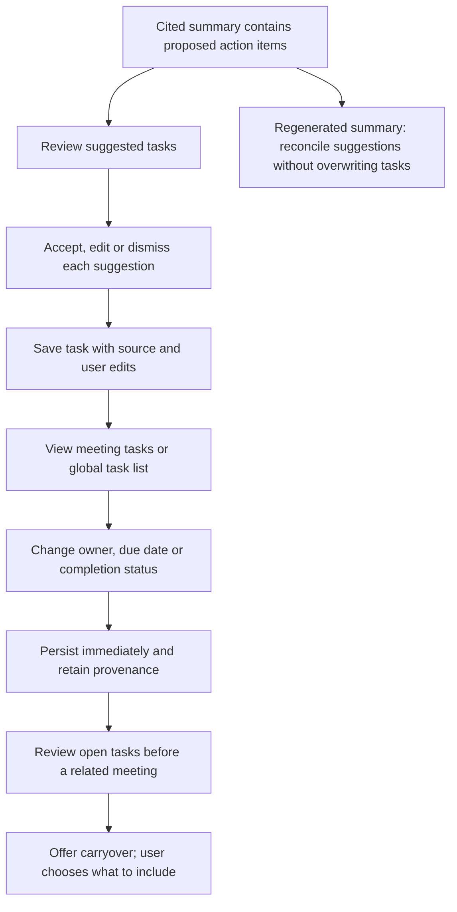
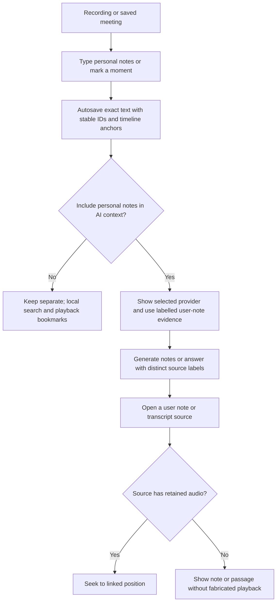
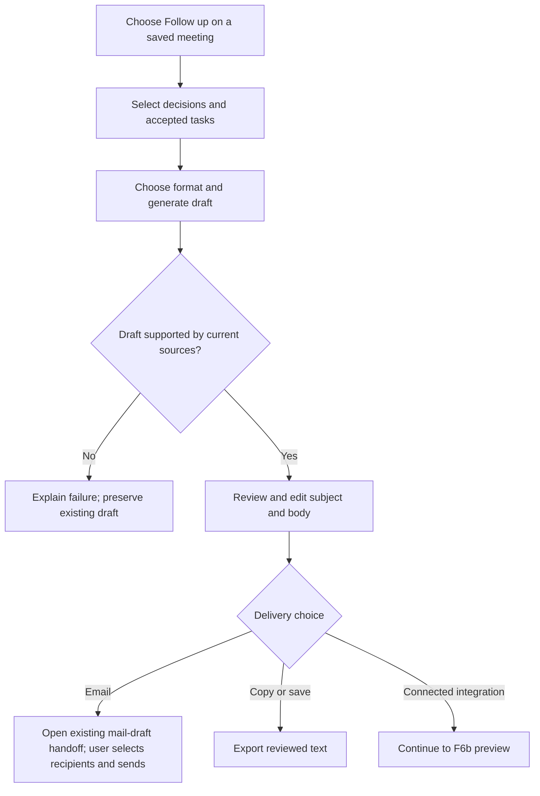
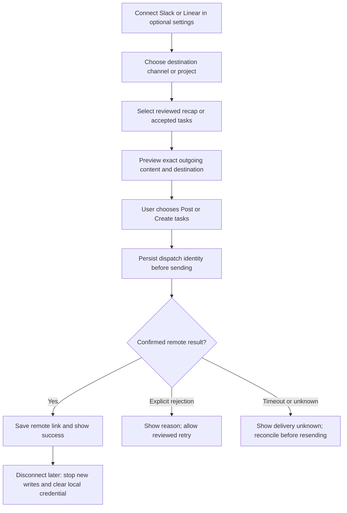

 

# ScribeLoop meeting workspace — delivery plan

Status: implementation started; F1 slices 1–3 are in progress. Updated 2026-11-10.

Goal: turn saved conversations into a searchable, cited workspace that helps users
remember decisions and follow through. Deliver six independently usable increments
with explicit acceptance gates. No milestone is complete merely because its API or
UI exists.

This plan extends the existing product; it does not reopen or mark earlier phases
complete. Older Phase 2 documents describe historical provider restrictions.
Current provider selection and first-use behavior are defined by the desktop
settings and recording router, including AssemblyAI and Deepgram cloud routes and
existing explicit local options.

## Current foundation and boundaries

Already present: encrypted conversations/audio, transcript revisions and speaker
labels, structured cited summaries and action-item extraction, calendar links,
manual transcript edits, retained-audio playback, provider selection, and email
export/draft handoff. Extend these; do not build competing copies.

`embeddings_chunks` and vector helpers are now being promoted into the F1/F2
hybrid-search path. Existing extracted action items are summary content, not a task
tracker. Existing summary instructions are not a template library. Existing email
sharing opens a draft; it does not send email.

Delivery rules:

- Native macOS UX first. Preserve saved workspaces and settings during migrations.
- Keyword search and bundled local Hybrid search stay on this Mac. Remote Hybrid
  uses the explicitly selected embedding provider for transcript chunks and queries.
  Hybrid searches run on Submit; no API request occurs on each keystroke. Search/Ask
  do not load an ASR model or upload audio.
- Use the configured notes LLM for Ask and generated drafts. Show the destination
  and scope. No implicit fallback to another provider or automatic paid retry.
- Scope defaults to the current conversation; expanding to multiple/all meetings
  is explicit. Audio retention expiry does not delete preserved transcript text.
- Cite stable source IDs, meeting IDs and revisions. Reject nonexistent or
  out-of-scope sources. Treat transcripts, personal notes and retrieved text as
  data, never as instructions to execute tools or send messages.
- Respect edits, selected revisions, deletion and person-forgetting in derived
  indexes/caches. Do not mix old transcript text with a newer revision label.
- Sending messages and creating external tasks require an explicit reviewed action.
  A generated draft never sends itself.

## Delivery order and dependencies

Ship **F1 → F2 → F3 → F4 → F5 → F6**. F2 retrieves over F1's hybrid lexical and
semantic index. F3 and
F4 can reuse existing structured summaries. F5 extends source types and requires
rechecking F2/F3/F6 grounding against that new source type.

### Shared acceptance fixture and measurement

Create a versioned, synthetic/redistributable business-meeting corpus: at least
30 meetings, 10 recurring topics, English and Vietnamese/code-switching examples,
speaker renames, amended decisions, conflicting dates, unclear speech and deleted
meetings. Include repeated meeting names and meetings with no audio retained.
Maintain 40 labelled retrieval queries and 40 grounded questions (including 10
unanswerable/conflicting questions). Ground truth is reviewed separately from
model output. Do not use private recordings without current authorization.

Performance targets below are proposed release gates, not measured results. Record
machine, OS, corpus size, provider/model, timing boundaries and runs. Measure local
search separately from provider latency. If a gate is missed, report the miss and
revise the implementation or explicitly revise this plan; do not silently waive it.

## F1 — Search all conversations

**User outcome:** find a past discussion and open the exact relevant passage.

**Scope:** search titles, selected saved transcript revisions and current summaries;
filter by date, meeting and linked person. Return meeting title/date, snippet,
speaker, source type and timestamp where available. Start with keyword/full-text
retrieval and add optional multilingual semantic retrieval, fused with deterministic
reciprocal-rank fusion. Use encrypted local indexes in the existing
workspace database, with an FTS capability check and migration/rebuild path.
Summary hits open the summary source; transcript hits open the passage. Support
expired audio by offering transcript navigation without a broken Play action.

Implementation slices:

1. Revision-aware index and incremental, resumable backfill. **Implemented; acceptance measurement pending.**
2. Bounded paged query API, ranking and filters. **Implemented; corpus ranking measurement pending.**
3. Native search entry/results, keyboard navigation and source opening. **Implemented; installed-app UX validation pending.**
4. Edit/delete/rename invalidation, measurement and acceptance report.

Current implementation notes: search documents and state live inside the encrypted
workspace; FTS5 is capability-checked with a disclosed basic-search fallback.
Queries reconcile changed meeting fingerprints before reading results, so selected
revision replacement, transcript edits, title changes, current summary changes and
person changes cannot silently reuse an old indexed fingerprint. Per-meeting
transactions and deterministic document IDs make interrupted reconciliation
resumable without duplicate hits. Deletion explicitly removes FTS shadow content
before purging the meeting. The native Search sheet supports meeting, date and
person filters and opens transcript citations or notes. Do not mark F1 complete
until the remaining fixture, performance, playback and installed-app gates below
are measured.

Audit remediation (2026-11-10): default search now indexes only grounded summaries
whose revision and transcript hash are current; unverifiable legacy/provisional
notes are excluded and index version 2 forces stale documents to rebuild. Both the
native control and backend require the first-use agreement and an idle recording/
processing state. Desktop reconciliation stays on the owning database thread but
cooperatively yields between fingerprint batches and indexed meetings, preventing
the cold build from monopolizing the event loop. Latest-request binding prevents
an older queued result from replacing a newer query or a cleared field.

UX audit remediation (2026-11-10): FTS index version 3 no longer duplicates each
meeting title into every transcript and summary row. Title queries therefore return
the dedicated title result instead of unrelated passages from that meeting. Delete
commands now use the exact indexed column values, preventing orphaned title tokens
during rename/reconciliation. Clearing or closing Search invalidates the outstanding
request so a late response cannot repopulate the sheet; title hits open Transcript.

Hybrid-search amendment (2026-11-10): Settings offers Keyword only or Hybrid.
Hybrid has an independent embedding provider: bundled local multilingual, OpenAI,
Ollama, LM Studio, or a custom OpenAI-compatible endpoint. Each vector-index
generation is bound to the provider, model, output dimensions, normalization and
implementation version. A generation is rebuilt when any field changes; vectors
from different models or shapes are never mixed. Meeting scope is applied inside
nearest-neighbour retrieval, before results can become evidence. Lexical search
remains available while a semantic model is missing, offline or rebuilding, with
the reduced mode disclosed. No provider fallback and no automatic paid retry are
allowed. Remote embedding sends transcript chunks while indexing and query text
while searching to the explicitly selected provider; both must be identified as
cloud processing in Settings.

Implementation update (2026-11-11): the selector lives in Models. Keyword remains
the default. Local Hybrid bundles the official Apache-2.0 IBM Granite multilingual
97M R2 INT8 ONNX model at revision `835ad14087e140460703cf0fae09f97d469d65c2`,
384-dimensional CLS embeddings with L2 normalization. Build-time SHA-256 checks
verify every model/tokenizer asset; runtime never downloads weights. Remote routes
use `/embeddings`; expected output dimensions are checked before a transaction can
replace index rows. OpenAI third-generation models receive the requested dimensions;
other compatible endpoints must return their model's configured native size.
Scope-restricted queries compute exact distance inside the permitted meeting set,
avoiding global candidate starvation. Ask excludes title documents before ranking
so titles cannot consume its evidence budget. Failed semantic requests visibly
return keyword results and require an explicit next submission to retry.
Person-forgetting and conversation deletion purge every registered generation.
Native packaging pins ONNX Runtime 1.18.1 to retain the macOS 13 deployment floor.

Gemini amendment (2026-11-11): new settings default to Gemini for the Hybrid
embedding provider (`gemini-embedding-001`, 768 dimensions). The native Gemini
batch-embedding API requests the exact output size and uses separate document/query
retrieval task types. Keyword-only stays the initial search mode; choosing this
default alone does not upload a transcript. Existing explicit provider choices are
preserved. The standard Gemini destination may reuse the saved Gemini notes key;
other providers and custom URLs cannot inherit it.

Recorded development-Mac scale result for a synthetic 1,000-meeting/100,000-segment
SQLCipher workspace: 101,000 search documents, 4.419 s cold build, 71.05 ms warm
p50, 79.63 ms warm p95 and 82.12 ms warm maximum over 100 queries. This passes the
warm ≤500 ms gate. Cold indexing remains reported rather than hidden; physical
search-during-recording is prevented by UI and server controls.

**Finished only when:**

- [ ] All currently selected saved revisions are indexed; old revisions do not leak
  into default results. Interrupted backfill resumes without duplicated hits.
- [ ] Title, transcript and summary search plus all three filters work in the native
  app, including Vietnamese diacritics and documented accent-insensitive matching.
- [ ] At least 36/40 labelled queries put a relevant passage in the first five hits.
- [ ] Every result opens the correct meeting/source/revision; transcript navigation
  lands on its highlighted segment and available playback starts at that segment.
- [ ] Edits and deletes are reflected before a new query can return stale content;
  backfill status is visible and incomplete indexing is disclosed.
- [ ] On the recorded development Mac, a 1,000-meeting/100,000-segment fixture has
  p95 query response ≤500 ms over 100 warm queries; cold-start timing is reported.
- [ ] No network request occurs during keyword search. Keyboard access, empty,
  loading, index-unavailable and audio-expired states are verified.

## F2 — Ask your meetings

### Audit remediation — 2026-11-12

Branch: `fix/search-ask-quality-and-privacy`. This is implementation work;
the independent production-model release evaluation remains a separate gate.
Implementation and verification evidence: `SEARCH_ASK_AUDIT_REMEDIATION.md`.
Remediation implemented: 882 full-suite tests pass; 35 focused tests pass after
the final request-accounting adjustment. Native compilation/build/signature and
real Gemini/UI checks pass. The original architecture transcript moved from rank
13 to rank 1; Search and saved Ask citations now visibly highlight 3:12. Synthetic
local recall is 38/40 at five passages and 39/40 at twenty for both Search and Ask.
Independent production-scale/multilingual grounding release gates below remain open.

| Finding | Planned change | Finished when |
| --- | --- | --- |
| Weak passage ranking | Preserve chunk rank, score bounded source excerpts and remove common query-word noise | Versioned multilingual corpus improves final passage recall; exact matches outrank adjacent boilerplate |
| Source navigation | Resolve cited segment to its containing lazy turn before scrolling/highlighting | Search and Ask open middle/end/grouped/page-boundary sources at the actual cited text |
| Lost long-source evidence | Carry matched excerpt offsets and full-source fingerprints through evidence/history | A tail match beyond 48 KiB reaches generation without uploading the full source |
| Filter starvation | Apply meeting/date/person eligibility before nearest-neighbor selection | Excluded candidates cannot crowd out eligible results |
| History and Unicode budgets | Separate excerpt/source hashes; budget actual UTF-8 provider bodies | New clipped answers reopen and follow up; equivalent Vietnamese input respects wire-byte limits |
| Consent revocation | Cancel registered jobs and check an authorization generation before every outbound request and result publication | Same-client and cross-client revocation start no subsequent embedding/answer request |
| Performance accounting | Measure whole request plus indexing/retrieval/answer stages and count embedding/answer requests separately | UI/history show total latency and all provider work, including cold indexing |

Regression checks use synthetic sources and fake providers first. Repeat the saved
40-query corpus, full suite and native compilation, then verify the rebuilt app's
navigation and configured-provider flow. Do not replace bounded RAG with a full
transcript fallback, add automatic paid retries, or mark unrun acceptance checks done.

Live-failure fix (2026-11-11): the supplied selected-meeting architecture question
reproduced `ask_missing_limit_notice` with the real Gemini provider. Valid cited
answers were discarded when retrieval was bounded and the model omitted a caveat.
The app now supplies its own coverage notice after citation/schema validation.
Sanitized HTTP/validation diagnostics and code-only events replace the generic
failure banner. Scope/citation checks and bounded evidence remain enforced, with
no automatic paid retries. Regression tests cover the notice and invalid citations;
the complete suite passes (862 tests). The rebuilt app answered the exact question
with the real Gemini provider in approximately 3.9 seconds: architecture supports
AI Agent development and plugin integration, with clickable sources. Hybrid RAG
sent 14 KB of evidence, bounded at 20 passages; no full transcript was uploaded.

Hybrid key UX (2026-11-11): show the masked saved key and Saved badge outside
the password input, distinguish a shared notes key from a dedicated embedding key,
and show unsaved replacement / missing-key states. A saved credential does not
claim provider access has been tested.

Hybrid prerequisite (2026-11-11): Ask requires the user to enable Hybrid in
Settings → Models → Meeting search. Enforce this for questions, evidence and
history in the desktop API as well as the native client. Keyword-only users see
an explanation and a direct settings link. Settings explains semantic retrieval,
the embedding destination and the separate notes-provider destination. No automatic
enablement or full-transcript fallback is permitted.

Chosen-meeting UX refinement (2026-11-11): replace the short inline checklist with
a searchable, larger draft picker. Selecting Chosen meetings opens the picker;
Apply updates scope/history once, while Cancel preserves the applied selection.
Show selection count, selected-only review, additive filtered selection, a 100-item
limit and explicit older-history loading. Disable scope edits during a running Ask.
Implemented and verified in the rebuilt macOS app: accent-insensitive `kiem tra`
matched Vietnamese titles; filtered selection retained an earlier choice; Cancel
kept the prior one-meeting scope; Apply changed it to two meetings; an empty
selection disabled Apply. The user's original scope and question were restored.
Native compilation and deep signature verification passed. Older-history paging
and the 100-item cap are implemented but were not exercised against the user's
eight-conversation workspace. No provider request was submitted by this UX check.

**User outcome:** ask “What did we agree about pricing?” and inspect the evidence.

**Scope:** a meeting-scoped conversation plus explicitly selected meetings or all
meetings. Retrieve relevant text locally, then send a bounded evidence packet to
the chosen notes provider. Answers distinguish decisions, proposals and conflicting
accounts, and link factual claims to sources. Show which meetings were searched.
Hybrid retrieval combines exact lexical hits (important for names, identifiers and
dates) with multilingual semantic hits (paraphrases and cross-language questions).
Explain when semantic retrieval is unavailable or the combined retrieval found
insufficient evidence rather than claiming exhaustive knowledge.

Implementation slices:

1. Retrieval/evidence contract, source scopes and request budget. **Implemented.**
2. Structured cited-answer generation, validation and cancellation. **Implemented.**
3. Native Ask interface, evidence drawer and follow-up questions. **Implemented.**
4. Revision-aware history and invalidation. **Implemented; the labelled 40-question
   human grounding evaluation remains a release gate.**

Initial bounds: retrieve ≤20 passages and ≤48 KB evidence per answer, generate
≤2,000 output tokens, and make at most one generation request per submitted
question. Display truncation. Never silently drop the user's scope or widen it.

**Finished only when:**

- [ ] Scope is visible and enforced server-side for retrieval, generation, follow-up
  history and every citation. No answer draws from a meeting outside the scope.
- [ ] All rendered citation IDs resolve to the correct permitted meeting/revision;
  invalid IDs are rejected rather than displayed as working citations.
- [ ] On the 40-question set, ≥90% of answerable questions pass human grounding
  review, and all 10 unanswerable/conflicting cases avoid invented certainty.
  Report citation existence separately from semantic support; one does not prove
  the other. Record the configured model and repeat the evaluation three times.
- [ ] Unsupported factual claims are withheld or explicitly marked uncertain;
  answers can say “not found in the retrieved evidence.”
- [ ] Changes to transcript selection/text or deleted sources invalidate affected
  saved answers. Source deletion purges dependent answer text/evidence caches.
- [ ] Cancellation, offline/quota errors and ambiguous dispatch have usable recovery
  with no automatic paid retry. First useful status appears within 1 second;
  end-to-end provider timing and request usage are recorded, not guaranteed.
- [ ] Prompt-injection fixtures cannot widen scope, invoke tools, reveal keys or
  trigger outbound messages. No audio is uploaded by Ask.

## F3 — Meeting templates

**User outcome:** choose a useful notes format without writing a large prompt.

**Scope:** General, Stand-up, Customer call, Interview, Planning and One-to-one.
Templates affect presentation and desired sections while preserving source checks.
Support a default template, a per-meeting override and editable custom templates.
Keep existing summary instructions as a separate personal guidance layer; preview
which template/guidance will apply. Snapshot template version and guidance when
notes generation starts.

**Finished only when:**

- [ ] All six built-in templates produce the intended sections on representative
  fixtures; absent facts are omitted rather than invented to fill headings.
- [ ] Default selection and per-meeting overrides survive quit/reopen; changing a
  template never silently regenerates or rewrites existing notes.
- [ ] Custom templates can be created, edited, previewed and deleted; meetings
  retain their generation snapshot if the original template is later deleted.
- [ ] Template instructions cannot disable citation checks or source scoping.
- [ ] Regeneration creates a new summary version; failures preserve the previous
  version. Existing manual instructions migrate without being overwritten.
- [ ] Native selection/preview, keyboard navigation and exports work for both
  English and Vietnamese content. Provider failures and unsupported schemas are
  explained without silently selecting another model.

## F4 — Action-item tracking

**User outcome:** turn a meeting commitment into a task and see what remains open.

**Scope:** promote existing extracted actions into durable tasks with title, linked
meeting/evidence, editable owner, optional due date and Open/Done/Dismissed status.
Provide per-meeting actions and an all-meetings task list with overdue/date/owner
filters. Ambiguous owners/dates remain unset. Carryover is suggested when reviewing
related meetings, never presented as a newly agreed commitment.

**Finished only when:**

- [ ] User can accept/edit/dismiss suggestions, create a manual task, mark done and
  reopen; state persists across restart and is independent of summary regeneration.
- [ ] Repeated generation cannot duplicate accepted tasks or overwrite manual
  title/owner/date/status changes. Use stable suggestion fingerprints, not text
  matching alone; ambiguous matches require review.
- [ ] Extracted tasks retain working source links; manual tasks are labelled manual.
  No owner identity or absolute due date is invented from an ambiguous phrase.
- [ ] Related-meeting carryover is explicitly labelled and accepted by the user;
  it never becomes evidence that someone repeated or approved the commitment.
- [ ] Deleted meetings remove their linked tasks and derived evidence. Person
  forgetting removes that person's owner link/name from derived task data; manual
  task deletion has an explicit, recoverable undo behavior.
- [ ] Filters, empty states, overdue timezone handling and all native edit controls
  pass fixture and UI checks. Existing summaries remain readable after migration.

## F5 — Personal notes and important moments

**User outcome:** jot down context or mark a moment while staying in the call.

**Scope:** an autosaving note editor and a Mark moment shortcut during recording;
notes remain editable afterward. Preserve exact user text separately from ASR and
LLM output. Bookmarks use the recorder timeline, including a defined pause policy:
marks during pause attach to the last included audio position and say “during
pause”; they do not imply excluded audio was saved.

User-note context is opt-in per meeting for summary/Ask use, with destination shown.
It is a distinct evidence type: “Your note,” not “someone said this.” Including user
notes never permits a false audio citation. Personal notes remain searchable locally
without authorizing a cloud LLM upload.

**Finished only when:**

- [ ] Exact user text autosaves within 1 second of inactivity and immediately on
  navigation/normal quit. Force-stop recovery preserves acknowledged saves; unsaved
  status is visible. No LLM output overwrites the personal-note document.
- [ ] Marks made during recording resolve within 500 ms of the selected captured
  audio position on generated timing fixtures. Pause/resume and expired-audio
  behavior are tested and clearly labelled.
- [ ] Notes and marks survive restart and transcript replacement. Anchors use
  recording time, not transient ASR segment IDs; unavailable anchors are explained.
- [ ] AI inclusion defaults off for existing personal notes. Turning it on clearly
  identifies the destination and the personal-note source type under the app's
  existing first-use agreement; no extra per-run consent checkbox is introduced.
- [ ] Search, Ask and templates pass regression cases with contradictory personal
  notes versus spoken evidence; the UI preserves attribution and uncertainty.
- [ ] Keyboard shortcut, editor focus, autosave recovery and use while recording
  are verified. Deleting a meeting removes its notes, marks and derived contexts.

## F6 — Follow-up drafts and integrations

**User outcome:** review a useful recap and send approved work to the right place.

Deliver in two separately accepted slices. **F6 overall is complete only when both
F6a and F6b pass.** Existing email-export/draft handoff remains the delivery path;
ScribeLoop does not gain an automatic email-send capability.

### F6a — Follow-up drafts

Generate a recap from selected, cited decisions and accepted tasks. Allow tone,
length, editable subject/body and preview. Explain if notes are stale; offer a
separate explicit regeneration action. Opening a draft must not silently regenerate
notes or upload audio. Keep evidence visible in-app; let the user choose whether
source references appear in the outbound draft.

**F6a finished only when:**

- [ ] Draft generation uses selected decisions/tasks and current evidence; no
  invented promise, deadline or owner appears in the acceptance fixtures.
- [ ] User edits survive navigation/restart and are not overwritten by regeneration
  without an explicit replacement choice. Previous draft is recoverable.
- [ ] Copy, save and existing email-draft handoff work; no email is sent by
  ScribeLoop, and calendar attendees are not silently inserted as recipients.
- [ ] Stale sources, provider failures, no mail client and cancelled handoff have
  recovery states. Exports disclose plaintext handling and respect existing limits.

### F6b — Slack and one task-system connector

First connector set: **Slack + Linear**, proposed defaults for implementation.
Jira follows as a separate increment if needed; do not build both task systems at
once. Connect accounts explicitly with least needed scopes; persist secrets in
Keychain. Manual destination selection and preview precede every external write.
A task's owner must map to an actual destination identity chosen by the user.

**F6b finished only when:**

- [ ] Slack posting and Linear task creation each pass a real sandbox-account
  end-to-end test, including destination selection, preview and returned remote link.
- [ ] Cancel before final confirmation performs no write. The exact reviewed
  destination/content are bound to the dispatch; later UI edits require new review.
- [ ] A double-click/reconnect cannot duplicate a confirmed dispatch. Ambiguous
  timeouts never cause blind resend; reconcile where the provider permits it and
  otherwise require the user to inspect the destination.
- [ ] Missing scopes, expired credentials, rate limiting and unavailable projects /
  channels are handled without exposing secrets or switching destinations.
- [ ] Disconnect clears local connector credentials and prevents queued writes;
  explain that previously posted content remains in the external service.
- [ ] Connector tests verify no meeting transcript/audio is attached by default.
  Only the previewed recap/tasks are transmitted. Local meeting deletion clears
  connector caches but does not silently delete already-published external content.

## Architecture and data work

| Area           | Planned addition                                                         | Existing path to extend                                                                  |
| -------------- | ------------------------------------------------------------------------ | ---------------------------------------------------------------------------------------- |
| Search         | Revision-aware documents, local FTS, backfill cursor, paged queries      | `storage/sessions.py`, database migrations; assess `storage/vectors.py` later        |
| Ask            | Scoped retrieval, evidence contract, cited answers/history, invalidation | `llm/summary_provider.py`, `api/desktop_contract.py`, authenticated command receipts |
| Templates      | Versioned templates, default and meeting override, provenance            | Existing structured summary and rolling-notes pipeline                                   |
| Tasks          | Durable tasks, suggestion/source links, edits and status                 | Existing grounded summary action items and people links                                  |
| Personal notes | Separate authored documents, marks, autosave and evidence IDs            | Encrypted workspace, recording timeline and playback                                     |
| Follow-up      | Saved drafts, evidence selection and destination adapters                | `api/email_exports.py`, native `EmailSharing.swift`                                  |
| Connectors     | Keychain credentials, destination mappings, dispatch receipts            | Existing account/provider-secret patterns; no transcript-controlled tools                |

Schema decisions must be reviewed per increment. Every new source-bearing table
needs revision handling and tested delete/forget cleanup; avoid large catch-all
JSON state that makes those dependencies invisible.

## Shared finish gate for every increment

- [ ] Updated implementation docs and migration/rollback notes.
- [ ] Relevant Python/native regressions pass; existing capture, Stop, playback,
  summaries, permissions and provider-selection checks remain green.
- [ ] Native UI has verified loading, empty, success, error and cancellation states
  with keyboard operation and readable long English/Vietnamese content.
- [ ] Upgrade from a populated encrypted workspace preserves existing meetings,
  settings and keys. Index rebuilds do not require ASR reruns or audio reuploads.
- [ ] Delete/revision/person-forgetting invalidation is exercised end to end.
- [ ] No hidden provider switch, automatic paid retry or external write occurs.
- [ ] Evidence artifact records fixture versions, model/configuration, timings,
  quality results, limitations and failed gates—not just test counts.
- [ ] A development macOS build is installed and the user-facing feature can be
  reviewed. Signing/notarization and real physical-call release gates remain
  explicit separate requirements; do not call them completed by fixture tests.

## Delivery tracking

| Increment         | Status                                     | Depends on                            | Closeout artifact               |
| ----------------- | ------------------------------------------ | ------------------------------------- | ------------------------------- |
| F1 Search         | Not started                                | Existing selected revisions           | `SEARCH_CLOSEOUT.md`          |
| F2 Ask            | Implemented; acceptance evaluation pending | F1                                    | `MEETING_CHAT_CLOSEOUT.md`    |
| F3 Templates      | Not started                                | Existing summary schema               | `TEMPLATES_CLOSEOUT.md`       |
| F4 Tasks          | Not started                                | Existing action extraction            | `ACTION_TRACKING_CLOSEOUT.md` |
| F5 Personal notes | Not started                                | Recording timeline + source contracts | `PERSONAL_NOTES_CLOSEOUT.md`  |
| F6a Drafts        | Not started                                | F3/F4 and evidence contract           | `FOLLOWUP_DRAFTS_CLOSEOUT.md` |
| F6b Integrations  | Not started                                | F6a + connector credentials           | `INTEGRATIONS_CLOSEOUT.md`    |

The next implementation task is F1 slice 1: encrypted, revision-aware local search
index and its update/delete contracts, followed by the native search surface.
