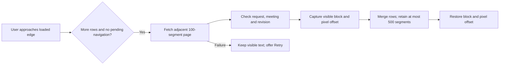

# Automatic transcript loading

Replace the Earlier/Later page controls with adjacent-page loading at user-scroll
edges. Keep explicit top/latest jumps and citation navigation. This builds on the
isolated navigation state from the scrolling trial.

## Flow

Only one page request runs at a time. Selection, explicit jumps and citations
supersede pending adjacent requests. Revision changes discard the old window.
Automatic loading keeps the current visible source, not the first row or latest
speech. Refresh replaces its requested range within the loaded window. Loading
state is isolated from notebook state. No provider calls or new permissions.

Finish conditions: bidirectional loading, bounded/deduplicated window, no missing
source IDs, stale response rejection, retryable failure, retained live-follow and
citation behavior, pixel-offset restoration regression, native build and bundle
verification. UI smoothness remains subject to testing on the user's machine.

## Verification — 17 November 2026

- Native reducer regressions passed: earlier/later merging, one in-flight request,
  500-segment eviction in both directions, unique source IDs, rejection/retry,
  revision mismatch and explicit navigation superseding an adjacent request.
- Existing paging, follow, rollover and citation regressions passed. Following
  rollover now retains the contiguous loaded window instead of replacing it.
- Native AppKit regression passed: prepending variable-height content preserves a
  visible source's pixel offset within 0.5 px. Render-isolation regressions passed.
- Production and synthetic preview builds completed; production bundle verification
  passed with no bundled recordings or operator transcription credential.
- Initial preview UI check loaded earlier speech across both page boundaries in
  the 230-segment fixture, without Earlier/Later controls. It exposed stale
  near-top state after restoration; completion now recomputes actual viewport
  position before updating navigation controls.
- Final preview was launched through Finder, but computer control returned
  `Invalid app` when binding its running bundle after the rebuild. Final UI
  verification of that correction and user scrolling acceptance remain pending.
  No cloud calls or user-recording modifications were made.

If a user moves across the resident window while a fetch is in flight, a response
that would evict the newly visible source is discarded. Rejected or timed-out
loads retain visible text and expose an explicit Retry. Loading state stays within
the navigation observer; it does not publish per-frame notebook changes.
